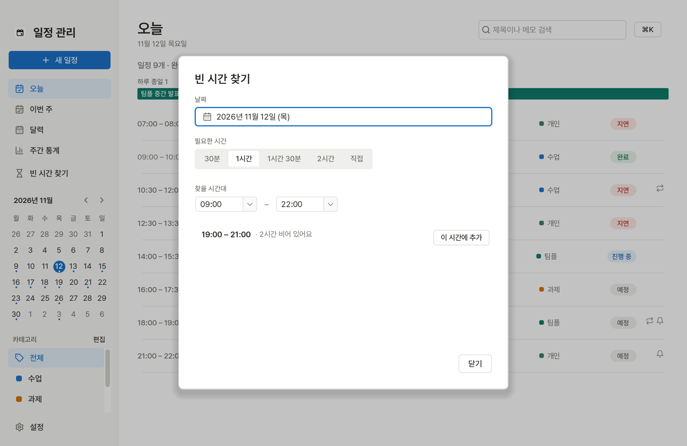
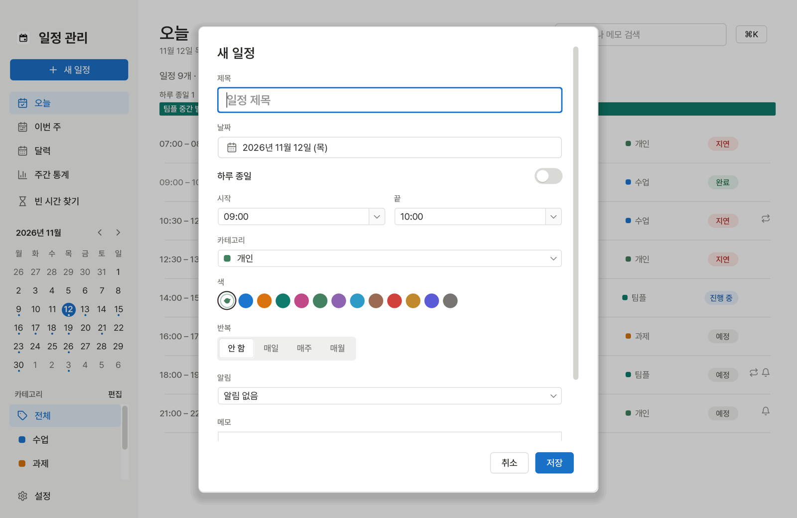

# 일정 관리

[](https://github.com/kim0040/proto/actions/workflows/ci.yml)
[](https://github.com/kim0040/proto/releases/latest)

수업, 과제, 팀플, 개인 일정을 한곳에서 관리하는 **Windows·macOS용 데스크톱 일정 관리 앱**입니다.
반복 일정, 알림, 겹침 경고, 빈 시간 찾기, 주간 통계에 더해 시간표에서 끌어서 옮기기, 되돌리기, 일정별 색, `⌘K` 명령 메뉴까지 들어 있고, 인터넷이나 계정 없이 내 컴퓨터에만 저장합니다.

대학교 "소프트웨어시스템분석및설계"(UML) 팀 프로젝트에서 **써 보면서 유스케이스를 뽑기 위해** 만든 프로토타입입니다.


## 목차

- [설치하기](#설치하기)
- [화면 둘러보기](#화면-둘러보기)
- [사용 방법](#사용-방법)
- [단축키](#단축키)
- [데이터가 저장되는 곳](#데이터가-저장되는-곳)
- [문제 해결](#문제-해결)
- [개발자용: 소스로 실행하기](#개발자용-소스로-실행하기)
- [프로젝트 구조와 문서](#프로젝트-구조와-문서)

---

## 설치하기

자바가 앱 안에 들어 있어서 **따로 설치할 것은 없습니다.** 아래 한 줄을 붙여 넣으면 경고 창 없이 설치하고 바로 엽니다.
더 자세한 방법(직접 내려받기, 업데이트, 지우기, 자주 묻는 질문)은 **[설치 안내](docs/설치-안내.md)**에 있습니다.

**Windows 10/11** — 시작 메뉴에서 `powershell`을 열고 붙여 넣은 뒤 Enter:

```powershell
irm https://raw.githubusercontent.com/kim0040/proto/main/scripts/install-windows.ps1 | iex
```

**Mac (M1 이후, Apple Silicon)** — `⌘ + Space`로 `터미널`을 열고 붙여 넣은 뒤 Enter:

```bash
curl -fsSL https://raw.githubusercontent.com/kim0040/proto/main/scripts/install-mac.sh | bash
```

같은 한 줄을 다시 실행하면 최신 버전으로 업데이트됩니다. 일정 데이터는 그대로 남습니다.

### 파일로 직접 받기

| 내 컴퓨터 | 바로 받기 |
| --- | --- |
| Windows 10/11 (64비트) | [설치 파일 (.msi)](https://github.com/kim0040/proto/releases/latest/download/ScheduleApp-windows-x64.msi) · [압축 파일 (.zip)](https://github.com/kim0040/proto/releases/latest/download/ScheduleApp-windows-x64.zip) |
| Mac (Apple Silicon) | [설치 파일 (.dmg)](https://github.com/kim0040/proto/releases/latest/download/ScheduleApp-macos-arm64.dmg) · [압축 파일 (.zip)](https://github.com/kim0040/proto/releases/latest/download/ScheduleApp-macos-arm64.zip) |

정식 서명이 없는 앱이라, 파일로 받으면 처음 한 번 경고 창이 뜹니다.
Windows는 **추가 정보 → 실행**, Mac은 **시스템 설정 → 개인정보 보호 및 보안 → 그래도 열기**를 누르면 됩니다 ([자세히](docs/설치-안내.md#직접-내려받아-설치하기)).

> Intel Mac용과 Linux용 파일은 없습니다. 이런 컴퓨터에서는 [소스로 실행](#개발자용-소스로-실행하기)할 수 있습니다.

---

## 화면 둘러보기

| 달력 | 이번 주 (다크 테마) |
| --- | --- |
|  |  |

| 주간 통계 | 빈 시간 찾기 | 새 일정 |
| --- | --- | --- |
|  |  |  |

- **오늘**: 오늘 일정을 시간순으로 보고 바로 완료 체크를 합니다. 하루 종일 일정은 맨 위 띠에 모입니다.
- **이번 주**: 월요일부터 일요일까지 시간표로 봅니다. 일정을 끌어서 옮기고, 빈 곳을 끌어서 새 일정을 만듭니다. 맨 위 "하루 종일" 줄에는 하루 종일 일정이 나옵니다. 창이 좁으면 날짜별 목록으로 바뀝니다.
- **달력**: 한 달을 보고, 날짜를 누르면 오른쪽(좁은 창에서는 아래)에 그날 일정이 나옵니다. 일정을 다른 날 칸으로 끌어 옮길 수도 있습니다.
- **주간 통계**: 일정 수, 완료율, 지연된 일정, 카테고리별 계획 시간, 요일별 일정 수를 보여 줍니다.
- **왼쪽 메뉴**: 작은 달력(일정이 있는 날은 점으로 표시, 날짜를 누르면 그날로 이동), 카테고리 목록, 설정이 있습니다. 아주 좁으면 아이콘 줄로 접힙니다.
- 새 일정·설정·빈 시간 찾기 같은 창은 별도 창이 아니라 **앱 창 안에 겹쳐 뜨는 시트**입니다. 바깥을 누르거나 `Esc`를 누르면 닫힙니다. 새 일정 창에 입력한 내용이 있으면 바깥을 눌러도 닫히지 않고 흔들리며, `Esc`를 누르면 버릴지 먼저 묻습니다.
- 오른쪽 위 `⌘K`(Windows는 `Ctrl+K`) 버튼이 [명령 메뉴](#k-명령-메뉴)입니다.

---

## 사용 방법

처음 켜면 예시 일정 5개(매주 반복되는 "팀플 회의" 포함)가 들어 있습니다. 둘러본 뒤 자유롭게 지우거나 고치면 됩니다.

### 일정 만들기

1. 왼쪽 위 **+ 새 일정**을 누릅니다. (`Ctrl+N`, Mac은 `⌘N`)
2. **제목**(50자까지), **날짜**, **시작·끝 시간**, **카테고리**를 정합니다.
3. 필요하면 **하루 종일**, **색**, **반복**(매일·매주·매월)과 **반복 종료일**, **알림**(5분·10분·30분 전), **메모**(200자까지)를 넣습니다.
4. **저장**을 누릅니다. 다른 일정과 시간이 겹치면 경고가 뜨고, **그래도 저장**이나 **돌아가기**를 고를 수 있습니다.

달력에서 날짜를 고른 뒤 **이 날에 일정 추가**를 누르면 그 날짜로 바로 만들 수 있습니다. 키보드로는 `C`만 눌러도 새 일정 창이 열립니다([단축키](#단축키)).

### 빈 곳에서 바로 만들기

**이번 주** 시간표에서 빈 곳을 **끌면** 끌어 놓은 날짜·시간(15분 단위)이 미리 채워진 새 일정 창이 열립니다. 빈 곳을 **두 번 누르면** 누른 시각(15분 단위로 내림)부터 1시간짜리로 열립니다. 제목을 넣고 **저장**을 눌러야 만들어지고, `Esc`로 끌기를 취소할 수 있습니다.

### 하루 종일

새 일정·수정 창의 **하루 종일** 스위치를 켜면 시간과 알림 칸이 접히고, 날짜만 정합니다. 하루 종일 일정은 **오늘** 화면 맨 위 띠와 **이번 주** 시간표 위의 "하루 종일" 줄에 나오고(많으면 `+3`처럼 접히며 화살표로 펼침), 달력에서는 시각 없이 표시됩니다. 시간을 차지하지 않으므로 겹침 경고와 빈 시간 찾기, 카테고리별 계획 시간에는 들어가지 않고, 알림도 오지 않습니다. 개수와 완료율에는 포함됩니다.

### 고치기, 지우기, 완료하기

- **고치기**: 일정 줄을 누르거나 `Enter`를 누릅니다.
- **지우기**: 일정 줄에서 `Delete`(또는 `Backspace`)를 누르거나, 수정 창의 **삭제**를 누릅니다. 반복 일정이 아니면 묻지 않고 바로 지우고, 화면에 잠깐 뜨는 안내의 **되돌리기**로 되살릴 수 있습니다.
- **완료**: 일정 줄 왼쪽의 동그라미를 누릅니다. 다시 누르면 완료가 취소됩니다.
- **우클릭 메뉴**: 일정 줄이나 시간표의 일정에서 마우스 오른쪽 버튼을 누르면 완료·수정·**복제**·**복사**·**색 바꾸기**·**내일로 미루기**·**다음 주로 미루기**·삭제가 나옵니다.
- **반복 일정**을 고치거나 지우거나 옮길 때는 **이 일정만** 또는 **앞으로 전부** 중에서 고릅니다. 반복 일정의 완료는 날짜마다 따로 기록됩니다.

### 끌어서 옮기기·크기 조절

- **이번 주** 시간표에서 일정을 끌면 날짜와 시간이 바뀝니다(15분 단위로 맞춰집니다). 일정 **아래쪽 가장자리**를 끌면 끝 시각만 바뀝니다. 화면 위·아래 가장자리 근처로 끌면 시간표가 저절로 스크롤됩니다. `Esc`를 누르면 끌기를 취소하고, 놓기 전에는 아무것도 바뀌지 않습니다.
- **하루 종일** 줄의 일정은 가로로 끌어 다른 날로 옮깁니다. **달력**에서도 일정을 다른 날 칸으로 끌어 날짜를 바꿀 수 있습니다(시간은 그대로).
- **키보드**: 일정에 포커스를 두고 `Alt`(Mac은 `⌥`) + `←` `→`는 하루씩, `↑` `↓`는 15분씩 옮깁니다. 오늘·이번 주·달력의 일정 줄에서도 같은 키로 옮깁니다(하루 종일 일정은 `←` `→`만).
- 옮기면 "일정을 옮겼어요"(크기만 바꾸면 "시간을 바꿨어요") 안내가 뜨고 **되돌리기** 버튼이 붙습니다. 다른 일정과 시간이 겹치면 막지 않고 안내에 "다른 일정과 시간이 겹쳐요"를 덧붙입니다.

### 되돌리기

- 일정을 만들거나 고치거나 지우거나 완료하거나 옮기거나 색을 바꾼 직후, 화면에 잠깐 뜨는 안내의 **되돌리기**를 누르면 그 변경이 취소됩니다. 그 뒤에 다른 변경이 있었다면 "그 뒤에 다른 변경이 있어 되돌릴 수 없어요"라고 알려 줍니다.
- `Ctrl/⌘+Z`는 마지막 변경을 되돌리고, `Ctrl/⌘+Shift+Z`(Windows는 `Ctrl+Y`도)는 되돌린 것을 다시 실행합니다. 명령 메뉴의 "되돌리기"·"다시 실행"도 같습니다.
- 최근 30번까지 기억하며, **앱을 끄면 기록은 사라집니다.** 카테고리를 만들거나 고치거나 지우는 일은 되돌리기 대상이 아니고, 카테고리를 지우면 그때까지의 기록이 비워집니다.

### 복제, 복사·붙여넣기

- **복제**: 우클릭 메뉴의 **복제**는 같은 날 같은 시간에 반복 없는 복사본을 하나 더 만듭니다.
- **복사·붙여넣기**: 일정 줄에 포커스를 두고 `Ctrl/⌘+C`로 복사하고, `Ctrl/⌘+V`로 지금 보는 화면의 날짜에 붙여 넣습니다(오늘 화면은 오늘, 이번 주는 고른 날, 달력은 고른 날). 같은 일정을 여러 번 붙일 수 있고, 반복은 빼고 완료 표시 없이 만들어집니다. 앱 안에서만 동작하며 컴퓨터의 클립보드는 쓰지 않습니다.

### 상태 배지

각 일정 옆의 글자 배지는 지금 시각을 기준으로 저절로 바뀝니다.

| 배지 | 뜻 |
| --- | --- |
| 예정 | 아직 시작 전 |
| 진행 중 | 지금 하는 중 |
| 지연 | 끝났는데 완료 체크를 안 함 |
| 완료 | 완료 체크를 함 |

### 카테고리와 검색

- 기본 카테고리는 **수업, 과제, 팀플, 개인**입니다. 왼쪽 메뉴에서 카테고리를 누르면 그 일정만 보입니다.
- 카테고리 옆 **편집**에서 추가, 이름 바꾸기, **색 바꾸기**, 삭제를 합니다. 지운 카테고리의 일정은 **개인**으로 옮겨지고, **개인**은 지울 수 없습니다.
- 오른쪽 위 검색창(`Ctrl/⌘+F`)에 글자를 넣으면 제목과 메모에서 찾습니다.

### 색

- **카테고리 색**: 카테고리 편집에서 줄 앞의 색 점을 누르면 12색 팔레트가 뜨고, 고르는 즉시 모든 화면에 반영됩니다.
- **일정 색**: 새 일정·수정 창의 **색** 줄이나 우클릭 메뉴의 **색 바꾸기**로 일정 하나만 다른 색으로 칠합니다. 맨 앞의 **카테고리 색**을 고르면 다시 카테고리 색을 따릅니다. 반복 일정은 반복 전체의 색이 바뀝니다. 명령 메뉴에서도 "선택한 일정 색 바꾸기"를 쓸 수 있습니다.
- **강조색**: 설정의 **강조색**에서 파랑·보라·초록·주황·분홍·빨강·흑백 중 고르면 버튼, 선택 표시, 오늘 표시의 색이 바뀝니다.

### ⌘K 명령 메뉴

`Ctrl/⌘+K`(또는 오른쪽 위 `⌘K` 버튼)로 여는 검색창 하나로 대부분의 동작을 합니다. 글자를 넣으면 맞는 항목이 줄지어 나오고, `↑` `↓`로 고르고 `Enter`로 실행하고 `Esc`로 닫습니다.

- **보기 이동**: 오늘·이번 주·달력·주간 통계 보기, 오늘로 이동, 카테고리별 보기
- **날짜로 이동**: `내일`, `3일 뒤`, `다음 주 금요일`, `11월 20일`, `2026-11-20`처럼 날짜를 입력하면 맨 위에 "…로 이동"이 나옵니다.
- **새 일정**: 입력한 글이 있으면 맨 아래에 "‘…’ 일정 만들기"가 붙어 그 제목으로 새 일정 창이 열립니다. "빈 시간 찾기"도 여기서 엽니다.
- **그 밖**: 되돌리기·다시 실행(할 수 있을 때만), 테마 바꾸기, 설정 열기, 단축키 보기, 선택한 일정 색 바꾸기. `ㅅㅈ`처럼 초성만 넣어도 찾습니다.

키보드에서 `?`를 누르면 모든 단축키를 보여 주는 안내 창이 열립니다.

### 알림

- 알림을 넣은 일정은 시간이 되면 앱 창 오른쪽 아래에 **"곧 시작해요"** 카드가 뜹니다. 창이 뒤에 있으면 작업 표시줄이나 Dock 아이콘이 깜빡입니다.
- 카드에서 **닫기**, **완료 처리**, **5분 뒤 다시**를 고를 수 있습니다.
- 알림은 **앱이 켜져 있을 때만** 옵니다. 창을 최소화해 두는 것은 괜찮습니다.

### 빈 시간 찾기

왼쪽 메뉴의 **빈 시간 찾기**에서 날짜, 필요한 시간(30분~2시간 또는 직접 입력), 찾을 시간대를 고르면 비어 있는 시간을 보여 줍니다. 결과에서 **이 시간에 추가**를 누르면 그 시간으로 새 일정 창이 열립니다.

### 설정

왼쪽 아래 **설정**(`Ctrl/⌘+,`)에서 바꿀 수 있습니다.

- **테마**: 시스템 / 라이트 / 다크
- **강조색**: 파랑 / 보라 / 초록 / 주황 / 분홍 / 빨강 / 흑백
- **애니메이션**: 화면 전환 효과 켜기·끄기
- **시작 화면**: 오늘 / 이번 주 / 달력
- **알림 소리** 켜기·끄기
- **빈 시간 찾기 기본 시간대**
- **데이터 폴더** 위치 보기와 **폴더 열기**, 앱 버전

---

## 단축키

`Ctrl`은 Windows, `⌘`는 Mac입니다(`Alt`는 Mac에서 `⌥`). 앱 안에서 `?`를 누르면 같은 목록이 나옵니다. 한 글자 키(`C` `T` `W` `M` `D` `←` `→` `?`)는 글자를 입력하는 칸에 포커스가 있거나 시트·명령 메뉴가 열려 있으면 동작하지 않고, 한글 입력 상태에서도 같은 자리의 키(`ㅊ` `ㅅ` `ㅈ` `ㅡ` `ㅇ`)로 동작합니다.

| 키 | 동작 |
| --- | --- |
| `C` / `Ctrl/⌘ + N` | 새 일정 (달력 보기에서는 고른 날짜로) |
| `T` | 오늘로 이동 |
| `D` / `W` / `M` | 오늘 / 이번 주 / 달력 보기 |
| `←` / `→` | 이전 / 다음 (주·달) |
| `Ctrl/⌘ + 1` / `2` / `3` / `4` | 오늘 / 이번 주 / 달력 / 주간 통계 |
| `Ctrl/⌘ + K` | 명령 메뉴 |
| `Ctrl/⌘ + F` | 검색창으로 이동 |
| `Ctrl/⌘ + ,` | 설정 |
| `?` | 단축키 안내 |
| `Ctrl/⌘ + Z` | 되돌리기 |
| `Ctrl/⌘ + Shift + Z` (Windows는 `Ctrl + Y`도) | 다시 실행 |
| `Ctrl/⌘ + C` / `Ctrl/⌘ + V` | 포커스가 있는 일정 복사 / 지금 보기의 날짜에 붙여넣기 |
| 일정 줄·시간표 일정에서 `Enter` / `Delete`·`Backspace` | 수정 열기 / 삭제 |
| 일정에서 `Alt + ←` `→` / `Alt + ↑` `↓` | 하루씩 / 15분씩 옮기기 (하루 종일 일정은 `←` `→`만) |
| 시간표에서 끌기 중 `Esc` | 끌기 취소 |
| `Esc` | 검색창: 글 지우기 → (좁은 화면에서) 검색창 접기 · 시트·명령 메뉴: 닫기 · 서랍 메뉴: 닫기 |
| 명령 메뉴에서 `↑` `↓` / `Enter` / `Esc` | 고르기 / 실행 / 닫기 |
| 달력·미니 달력에서 `←` `→` `↑` `↓` | 하루·한 주씩 이동 |
| 달력·미니 달력에서 `PageUp` / `PageDown`, `Home` | 한 달 이동, 오늘로 |
| 달력 격자에서 `Enter` / `Space` | 그날에 새 일정 / 그날 고르기 |
| 날짜 입력칸에서 `←→↑↓`, `PageUp/Down` | 날짜 조정 (±1일, ±7일, ±1달) |

---

## 데이터가 저장되는 곳

모든 일정은 인터넷이 아니라 **내 컴퓨터의 CSV 파일**에 저장됩니다. 바꿀 때마다 바로 저장되므로 따로 저장 버튼은 없습니다.

| 실행 방법 | 데이터 폴더 |
| --- | --- |
| 설치한 앱 (Mac) | `~/Library/Application Support/ScheduleApp` |
| 설치한 앱 (Windows) | `%APPDATA%\ScheduleApp` (보통 `C:\Users\<이름>\AppData\Roaming\ScheduleApp`) |
| 소스로 실행 (`./gradlew run`) | 프로젝트 폴더의 `data/` |

설정 화면의 **폴더 열기**로 바로 열 수 있습니다. 폴더 안의 파일은 이렇습니다.

| 파일 | 내용 |
| --- | --- |
| `schedules.csv` | 일정 (제목·메모에 쉼표나 줄바꿈이 있어도 안전하게 저장). 14칸이며 끝의 `all_day`(하루 종일)·`color`(일정 색)는 1.1.0에서 더했습니다. |
| `categories.csv` | 카테고리 (`id,name,color`) |
| `schedules-backup-날짜시각.csv`, `categories-backup-….csv` | 파일에 읽지 못한 줄이 있을 때, 덮어쓰기 전에 원본을 이 이름으로 보관 |
| `app.lock` | 앱이 두 번 켜지지 않게 하는 잠금 파일 (지우지 않아도 됨) |

- **다른 컴퓨터로 옮기기**: 두 컴퓨터의 앱을 모두 끄고 `schedules.csv`, `categories.csv`를 새 컴퓨터의 데이터 폴더에 복사합니다.
- **백업**: 위 두 파일만 복사해 두면 됩니다.
- **예전(1.0.0) 파일**: 칸이 모자란 예전 `schedules.csv`·`categories.csv`도 그대로 읽습니다. 하루 종일 아님, 카테고리 기본 색으로 읽히고, 다음 저장 때 새 모양으로 바뀝니다.
- 창 위치, 테마, 강조색 같은 설정은 CSV가 아니라 운영체제의 사용자 설정 저장소(`java.util.prefs`)에 저장됩니다.

---

## 문제 해결

| 증상 | 해결 |
| --- | --- |
| Mac에서 "확인되지 않은 개발자" / "열 수 없습니다" | **시스템 설정 → 개인정보 보호 및 보안 → 그래도 열기**를 누릅니다. 처음부터 [한 줄 설치](#설치하기)를 쓰면 이 창이 뜨지 않습니다. |
| Mac에서 "손상되었기 때문에 열 수 없습니다" | 터미널에서 `xattr -dr com.apple.quarantine /Applications/ScheduleApp.app`을 실행한 뒤 다시 엽니다. |
| Windows에서 "Windows의 PC 보호" | **추가 정보 → 실행**을 누릅니다. |
| "일정 관리가 이미 실행 중이에요."가 뜨고 꺼짐 | 이미 켜진 창이 있습니다. 작업 표시줄이나 Dock에서 찾아보세요. |
| "저장하는 중 문제가 생겼어요" | 데이터 폴더가 읽기 전용이거나, 엑셀 같은 프로그램이 CSV를 열고 있을 수 있습니다. 그 프로그램을 닫으면 다음 저장 때 다시 저장됩니다. |
| CSV를 직접 고쳤더니 일부 일정이 안 보임 | 읽지 못한 줄은 건너뛰고, 원본은 `…-backup-….csv`로 보관됩니다. 백업 파일에서 그 줄을 확인해 고치세요. |
| 알림이 안 옴 | 앱이 켜져 있어야 알림이 옵니다. 일정의 알림이 "알림 없음"이 아닌지, 앱을 켜기 전에 이미 지난 알림은 아닌지 확인하세요. |
| 글자가 너무 작거나 큼 | 운영체제의 화면 배율(Windows 디스플레이 배율, Mac 디스플레이 설정)을 따릅니다. |

---

## 개발자용: 소스로 실행하기

**JDK 17 이상**이 필요합니다. Gradle 래퍼가 들어 있어 Gradle은 따로 설치하지 않아도 됩니다.

```sh
git clone https://github.com/kim0040/proto.git
cd proto
./gradlew run          # Windows: gradlew.bat run
```

| 하는 일 | macOS / Linux | Windows |
| --- | --- | --- |
| 앱 실행 | `./gradlew run` | `gradlew.bat run` |
| 테스트 | `./gradlew test` | `gradlew.bat test` |
| 화면 캡처 (모든 화면, 여러 창 크기·테마) | `./gradlew screenshots` | `gradlew.bat screenshots` |
| 앱 묶기 (내 운영체제용) | `./gradlew jpackageImage packageZip jpackageInstaller` | 같음 (msi는 WiX 3 필요) |

- 화면 캡처는 임시 데이터로 찍어 `screenshots/`에 저장합니다 (git에는 올라가지 않습니다).
- 데이터 폴더를 직접 정하려면 `-Dproto.dataDir=<폴더>` 옵션을 줍니다.
- 새 버전 배포: `build.gradle`의 `version`을 올리고 커밋한 뒤 같은 번호의 태그(`v1.1.0` 등)를 올리면, GitHub Actions가 Windows·Mac 앱을 만들어 릴리즈에 붙이고 설치 스크립트로 실제 설치까지 확인합니다. 릴리즈 본문은 `docs/릴리즈-노트/<버전>.md`를 씁니다.

---

## 프로젝트 구조와 문서

Java 17 + Swing 데스크톱 앱입니다. 화면은 [FlatLaf](https://www.formdev.com/flatlaf/)로 꾸몄고, 글꼴은 Pretendard를 앱에 넣었습니다. DB·서버·외부 API 없이 CSV 파일만 씁니다.

### 패키지 (`src/main/java/proto`)

| 패키지 | UML 분류 | 하는 일 |
| --- | --- | --- |
| `app` | 시작점 | `Main`: 잠금·저장소·controller·타이머를 만들어 연결. `AppPaths`: 데이터 폴더 결정 (`app.dev`는 화면 캡처 실행기) |
| `entity` | 엔티티 (entity) | `Schedule`, `Occurrence`, `Category`, `RepeatRule` 등 데이터 |
| `control` | 제어 (control) | `ScheduleController`, `CategoryController`, `ReminderTimer`, `StateRefreshTimer`, `ChangeHistory`(되돌리기 기록). 화면이 부르는 유일한 문 |
| `logic` | 애플리케이션 로직 (application logic) | 검증·상태 계산·반복 펼치기·겹침/빈 시간/통계 계산·날짜 글 읽기(`DateQueryParser`). 화면 없이 테스트 가능 |
| `repository` | 저장소 (repository) | 일정·카테고리 목록을 들고 CSV로 저장·불러오기 (`ScheduleStore`·`CategoryStore` 인터페이스) |
| `server` | 서버 대비 (현재 사용 안 함) | 아래 "서버 대비 패키지" 참고 |
| `ui` | 경계 (boundary) | Swing 화면 (`ui.view`, `ui.dialog`, `ui.sheet`, `ui.command`, `ui.component`, `ui.theme`, `ui.motion`, `ui.layout`, `ui.dev`) |

규칙: ui는 entity·repository를 직접 건드리지 않고 controller를 거치며, controller는 리스너(인터페이스)로 ui에 결과를 알립니다.

### 문서

| 문서 | 내용 |
| --- | --- |
| [docs/설치-안내.md](docs/설치-안내.md) | 설치·업데이트·지우기 안내 (처음 쓰는 사람용) |
| [docs/릴리즈-노트/](docs/릴리즈-노트/) | 버전별 바뀐 점 |

유스케이스·기능 흐름표·클래스 목록 같은 수업용 설계 문서는 팀 안에서만 관리합니다.

### 기능 목록

F1 등록 · F2 조회(오늘/이번 주/달력) · F3 수정 · F4 삭제 · F5 완료 · F6 상태 자동 계산 · F7 카테고리 · F8 검색 · F9 반복 · F10 알림 · F11 자동 저장 ·
추가: F12 빈 시간 찾기 · F13 일정 겹침 경고 · F14 주간 통계 · F15 알림 다시 알리기 ·
1.1.0: F16 일정 옮기기(끌기·크기 조절·키보드) · F17 되돌리기·다시 실행 · F18 일정 복제·복사/붙여넣기 · F19 하루 종일 일정 · F20 색 지정(카테고리 색·일정 색·강조색) · F21 명령 메뉴·빠른 이동(`⌘K`, 한 글자 단축키, 날짜로 이동) ·
그 밖: 설정 화면 · 창 안에 뜨는 시트 · 창 크기에 따라 바뀌는 배치 · 중복 실행 막기 · 불러오기 문제 시 CSV 백업.

### 서버 대비 패키지 (`proto.server`)

나중에 서버를 붙일 때를 대비해 **따로 떼어 둔** 패키지입니다. 기본값은 꺼짐이라 지금 앱은 이 코드를 실행하지 않고, 서버에 접속하지도 않습니다.

- 켜는 법: 데이터 폴더의 `server.properties`에 `enabled=true`와 `baseUrl`을 적으면 "이 컴퓨터 우선 + 서버 동기화"로 동작합니다 (서버가 꺼져 있어도 CSV로 계속 동작합니다).
- 서버를 쓸지 말지는 `proto.app.StoreFactory` 한 곳에서만 정하고, controller는 `ScheduleStore`·`CategoryStore` 인터페이스만 봅니다.
- 안 쓰기로 하면 `src/main/java/proto/server`, `src/test/java/proto/server`, `StoreFactory`의 서버 분기를 지우면 됩니다.
- 수업용 클래스 다이어그램에서는 빼도 됩니다. 클래스 목록표에서도 마지막에 따로 모아 두었습니다.

---

## 라이선스

화면 글꼴 **Pretendard**에는 SIL Open Font License 1.1이 적용됩니다. 전문은 `src/main/resources/fonts/Pretendard-LICENSE.txt`에 있습니다.
FlatLaf는 Apache License 2.0입니다.
