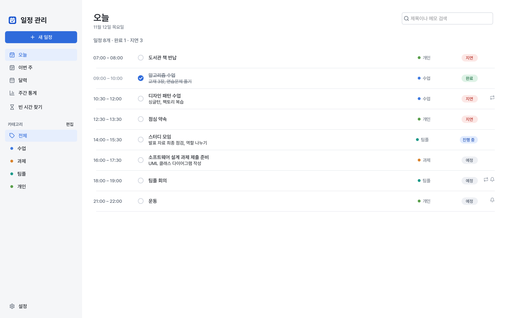
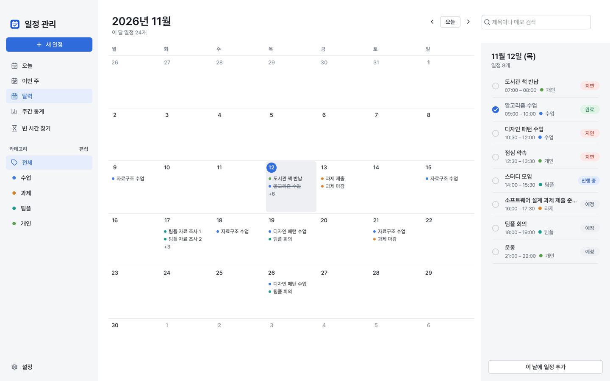
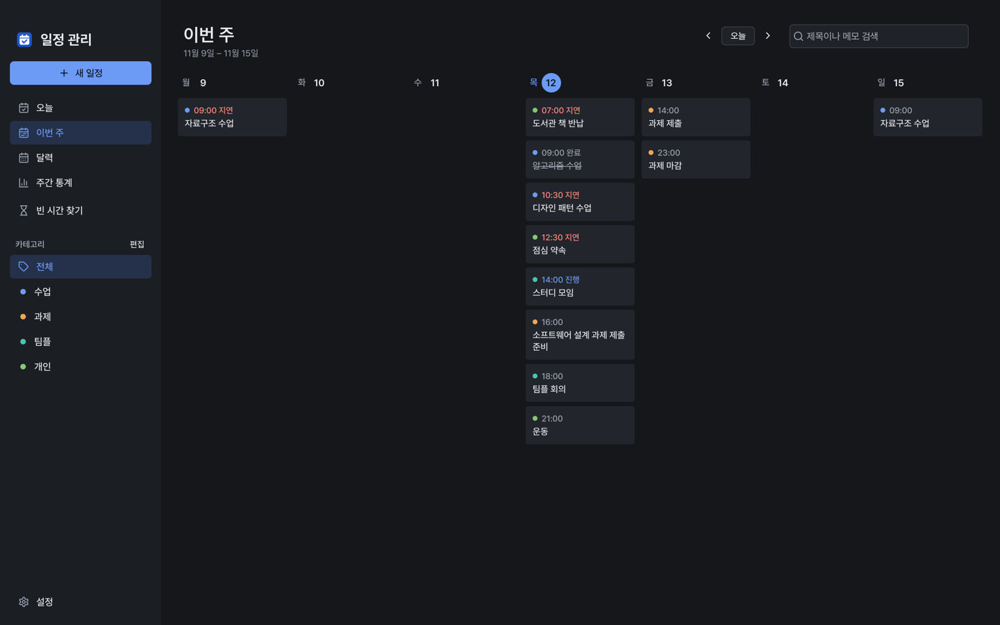
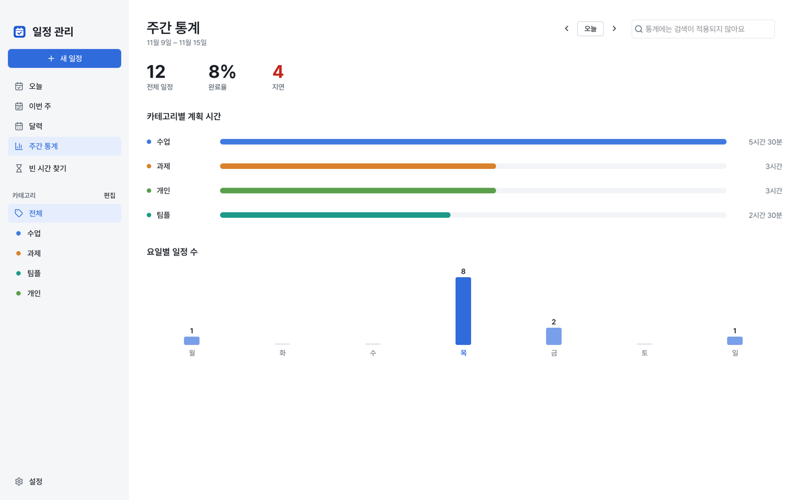

# 일정 관리

[](https://github.com/kim0040/proto/actions/workflows/ci.yml)
[](https://github.com/kim0040/proto/releases/latest)

수업, 과제, 팀플, 개인 일정을 한곳에서 관리하는 **Windows·macOS용 데스크톱 일정 관리 앱**입니다.
반복 일정, 알림, 겹침 경고, 빈 시간 찾기, 주간 통계까지 들어 있고, 인터넷이나 계정 없이 내 컴퓨터에만 저장합니다.

대학교 "소프트웨어시스템분석및설계"(UML) 팀 프로젝트에서 **써 보면서 유스케이스를 뽑기 위해** 만든 프로토타입입니다.
(계획은 [프로토타입-계획서.md](프로토타입-계획서.md), 구현 규칙은 [AI-구현-지시서.md](AI-구현-지시서.md)에 있습니다.)



## 목차

- [설치하기](#설치하기)
- [화면 둘러보기](#화면-둘러보기)
- [사용 방법](#사용-방법)
- [단축키](#단축키)
- [데이터가 저장되는 곳](#데이터가-저장되는-곳)
- [문제 해결](#문제-해결)
- [개발자용: 소스로 실행하기](#개발자용-소스로-실행하기)
- [프로젝트 구조와 문서](#프로젝트-구조와-문서)

---

## 설치하기

**[최신 버전 내려받기 →](https://github.com/kim0040/proto/releases/latest)**

릴리즈 페이지 아래쪽 **Assets**에서 내 컴퓨터에 맞는 파일 하나를 받습니다. 자바가 앱 안에 들어 있어서 **따로 설치할 것은 없습니다.**

| 내 컴퓨터 | 받을 파일 | 설명 |
| --- | --- | --- |
| Windows 10/11 (64비트) | `ScheduleApp-<버전>-windows-x64.msi` | 설치 파일 (추천) |
| Windows 10/11 (64비트) | `ScheduleApp-<버전>-windows-x64.zip` | 설치 없이 풀어서 실행 |
| Mac (Apple Silicon, M1 이후) | `ScheduleApp-<버전>-macos-arm64.dmg` | 설치 파일 (추천) |
| Mac (Apple Silicon, M1 이후) | `ScheduleApp-<버전>-macos-arm64.zip` | 풀어서 실행 |

> Intel Mac용과 Linux용 파일은 없습니다. 이런 컴퓨터에서는 [소스로 실행](#개발자용-소스로-실행하기)할 수 있습니다.
> 내 Mac이 어떤 칩인지는 화면 왼쪽 위 Apple 메뉴 → **이 Mac에 관하여**의 "칩" 항목에서 볼 수 있습니다.

### Windows에 설치

1. `…windows-x64.msi`를 더블클릭합니다.
2. **"Windows의 PC 보호"** 파란 창이 뜨면 **추가 정보** → **실행**을 누릅니다.
   (앱에 Microsoft 정식 서명이 없어서 뜨는 안내입니다. 처음 한 번만 하면 됩니다.)
3. 설치 위치를 고르고 **설치**를 누릅니다. 관리자 권한은 필요 없습니다.
4. 시작 메뉴나 바탕화면의 **ScheduleApp**으로 실행합니다.

zip을 받았다면 원하는 곳에 압축을 풀고, `ScheduleApp` 폴더 안의 `ScheduleApp.exe`를 실행합니다.

### Mac에 설치

1. `…macos-arm64.dmg`를 열고, **ScheduleApp**을 **Applications(응용 프로그램)** 폴더로 끌어 놓습니다.
2. 처음 한 번은 더블클릭하지 말고, Finder에서 앱을 **우클릭(또는 Control+클릭) → 열기**를 누른 뒤, 뜨는 창에서 다시 **열기**를 누릅니다.
3. 그래도 "열 수 없습니다"가 뜨면 **시스템 설정 → 개인정보 보호 및 보안**으로 가서 아래쪽의 **그래도 열기**를 누릅니다.
4. 다음부터는 그냥 더블클릭하면 됩니다. Dock에는 **일정 관리**로 보입니다.

> 앱에 Apple 정식 서명(유료 개발자 인증서)이 없어서 처음 한 번 위 과정이 필요합니다.
> 터미널을 쓸 줄 안다면 `xattr -dr com.apple.quarantine /Applications/ScheduleApp.app` 한 줄로도 됩니다.

### 지우기

- Windows: **설정 → 앱 → 설치된 앱**에서 ScheduleApp을 제거합니다.
- Mac: Applications 폴더의 ScheduleApp을 휴지통으로 옮깁니다.
- 앱을 지워도 내 일정 파일은 남습니다. 완전히 지우려면 [데이터 폴더](#데이터가-저장되는-곳)도 지웁니다.

---

## 화면 둘러보기

| 달력 | 이번 주 (다크 테마) |
| --- | --- |
|  |  |

| 주간 통계 | 빈 시간 찾기 | 새 일정 |
| --- | --- | --- |
|  |  |  |

- **오늘**: 오늘 일정을 시간순으로 보고 바로 완료 체크를 합니다.
- **이번 주**: 월요일부터 일요일까지 한눈에 봅니다. 창이 좁으면 날짜별 목록으로 바뀝니다.
- **달력**: 한 달을 보고, 날짜를 누르면 오른쪽(좁은 창에서는 아래)에 그날 일정이 나옵니다.
- **주간 통계**: 일정 수, 완료율, 지연된 일정, 카테고리별 계획 시간, 요일별 일정 수를 보여 줍니다.
- 창 크기에 맞춰 배치가 바뀝니다. 아주 좁으면 왼쪽 메뉴가 아이콘 줄로 접힙니다.

---

## 사용 방법

처음 켜면 예시 일정 5개(매주 반복되는 "팀플 회의" 포함)가 들어 있습니다. 둘러본 뒤 자유롭게 지우거나 고치면 됩니다.

### 일정 만들기

1. 왼쪽 위 **+ 새 일정**을 누릅니다. (`Ctrl+N`, Mac은 `⌘N`)
2. **제목**(50자까지), **날짜**, **시작·끝 시간**, **카테고리**를 정합니다.
3. 필요하면 **반복**(매일·매주·매월)과 **반복 종료일**, **알림**(5분·10분·30분 전), **메모**(200자까지)를 넣습니다.
4. **저장**을 누릅니다. 다른 일정과 시간이 겹치면 경고가 뜨고, **그래도 저장**이나 **돌아가기**를 고를 수 있습니다.

달력에서 날짜를 고른 뒤 **이 날에 일정 추가**를 누르면 그 날짜로 바로 만들 수 있습니다.

### 고치기, 지우기, 완료하기

- **고치기**: 일정 줄을 누르거나 `Enter`를 누릅니다.
- **지우기**: 일정 줄에서 `Delete`(Mac은 `Backspace`)를 누르거나, 수정 창의 **삭제**를 누릅니다.
- **완료**: 일정 줄 왼쪽의 동그라미를 누릅니다. 다시 누르면 완료가 취소됩니다.
- **반복 일정**을 고치거나 지울 때는 **이 일정만** 또는 **앞으로 전부** 중에서 고릅니다. 반복 일정의 완료는 날짜마다 따로 기록됩니다.

### 상태 배지

각 일정 옆의 글자 배지는 지금 시각을 기준으로 저절로 바뀝니다.

| 배지 | 뜻 |
| --- | --- |
| 예정 | 아직 시작 전 |
| 진행 중 | 지금 하는 중 |
| 지연 | 끝났는데 완료 체크를 안 함 |
| 완료 | 완료 체크를 함 |

### 카테고리와 검색

- 기본 카테고리는 **수업, 과제, 팀플, 개인**입니다. 왼쪽 메뉴에서 카테고리를 누르면 그 일정만 보입니다.
- 카테고리 옆 **편집**에서 추가, 이름 바꾸기, 삭제를 합니다. 지운 카테고리의 일정은 **개인**으로 옮겨지고, **개인**은 지울 수 없습니다.
- 오른쪽 위 검색창(`Ctrl/⌘+F`)에 글자를 넣으면 제목과 메모에서 찾습니다.

### 알림

- 알림을 넣은 일정은 시간이 되면 앱 창 오른쪽 아래에 **"곧 시작해요"** 카드가 뜹니다. 창이 뒤에 있으면 작업 표시줄이나 Dock 아이콘이 깜빡입니다.
- 카드에서 **닫기**, **완료 처리**, **5분 뒤 다시**를 고를 수 있습니다.
- 알림은 **앱이 켜져 있을 때만** 옵니다. 창을 최소화해 두는 것은 괜찮습니다.

### 빈 시간 찾기

왼쪽 메뉴의 **빈 시간 찾기**에서 날짜, 필요한 시간(30분~2시간 또는 직접 입력), 찾을 시간대를 고르면 비어 있는 시간을 보여 줍니다. 결과에서 **이 시간에 추가**를 누르면 그 시간으로 새 일정 창이 열립니다.

### 설정

왼쪽 아래 **설정**(`Ctrl/⌘+,`)에서 바꿀 수 있습니다.

- **테마**: 시스템 / 라이트 / 다크
- **애니메이션**: 화면 전환 효과 켜기·끄기
- **시작 화면**: 오늘 / 이번 주 / 달력
- **알림 소리** 켜기·끄기
- **빈 시간 찾기 기본 시간대**
- **데이터 폴더** 위치 보기와 **폴더 열기**, 앱 버전

---

## 단축키

`Ctrl`은 Windows, `⌘`는 Mac입니다.

| 키 | 동작 |
| --- | --- |
| `Ctrl/⌘ + N` | 새 일정 (달력 보기에서는 고른 날짜로) |
| `Ctrl/⌘ + F` | 검색창으로 이동 |
| `Ctrl/⌘ + 1` / `2` / `3` / `4` | 오늘 / 이번 주 / 달력 / 주간 통계 |
| `Ctrl/⌘ + ,` | 설정 |
| `Esc` | 검색창: 글 지우기 → (좁은 화면에서) 검색창 접기 · 대화상자: 닫기(취소) · 서랍 메뉴: 닫기 |
| 달력·미니 달력에서 `←` `→` `↑` `↓` | 하루·한 주씩 이동 |
| 달력·미니 달력에서 `PageUp` / `PageDown`, `Home` | 한 달 이동, 오늘로 |
| 달력 격자에서 `Enter` / `Space` | 그날에 새 일정 / 그날 고르기 |
| 일정 줄에서 `Enter` / `Delete`·`Backspace` | 수정 열기 / 삭제 |
| 날짜 입력칸에서 `←→↑↓`, `PageUp/Down` | 날짜 조정 (±1일, ±7일, ±1달) |

---

## 데이터가 저장되는 곳

모든 일정은 인터넷이 아니라 **내 컴퓨터의 CSV 파일**에 저장됩니다. 바꿀 때마다 바로 저장되므로 따로 저장 버튼은 없습니다.

| 실행 방법 | 데이터 폴더 |
| --- | --- |
| 설치한 앱 (Mac) | `~/Library/Application Support/ScheduleApp` |
| 설치한 앱 (Windows) | `%APPDATA%\ScheduleApp` (보통 `C:\Users\<이름>\AppData\Roaming\ScheduleApp`) |
| 소스로 실행 (`./gradlew run`) | 프로젝트 폴더의 `data/` |

설정 화면의 **폴더 열기**로 바로 열 수 있습니다. 폴더 안의 파일은 이렇습니다.

| 파일 | 내용 |
| --- | --- |
| `schedules.csv` | 일정 (제목·메모에 쉼표나 줄바꿈이 있어도 안전하게 저장) |
| `categories.csv` | 카테고리 |
| `schedules-backup-날짜시각.csv`, `categories-backup-….csv` | 파일에 읽지 못한 줄이 있을 때, 덮어쓰기 전에 원본을 이 이름으로 보관 |
| `app.lock` | 앱이 두 번 켜지지 않게 하는 잠금 파일 (지우지 않아도 됨) |

- **다른 컴퓨터로 옮기기**: 두 컴퓨터의 앱을 모두 끄고 `schedules.csv`, `categories.csv`를 새 컴퓨터의 데이터 폴더에 복사합니다.
- **백업**: 위 두 파일만 복사해 두면 됩니다.
- 창 위치, 테마 같은 설정은 CSV가 아니라 운영체제의 사용자 설정 저장소(`java.util.prefs`)에 저장됩니다.

---

## 문제 해결

| 증상 | 해결 |
| --- | --- |
| Mac에서 "확인되지 않은 개발자" / "열 수 없습니다" | [Mac에 설치](#mac에-설치)의 2~3번(우클릭 → 열기, 또는 그래도 열기)을 따라 합니다. |
| Mac에서 "손상되었기 때문에 열 수 없습니다" | 터미널에서 `xattr -dr com.apple.quarantine /Applications/ScheduleApp.app`을 실행한 뒤 다시 엽니다. |
| Windows에서 "Windows의 PC 보호" | **추가 정보 → 실행**을 누릅니다. |
| "일정 관리가 이미 실행 중이에요."가 뜨고 꺼짐 | 이미 켜진 창이 있습니다. 작업 표시줄이나 Dock에서 찾아보세요. |
| "저장하는 중 문제가 생겼어요" | 데이터 폴더가 읽기 전용이거나, 엑셀 같은 프로그램이 CSV를 열고 있을 수 있습니다. 그 프로그램을 닫으면 다음 저장 때 다시 저장됩니다. |
| CSV를 직접 고쳤더니 일부 일정이 안 보임 | 읽지 못한 줄은 건너뛰고, 원본은 `…-backup-….csv`로 보관됩니다. 백업 파일에서 그 줄을 확인해 고치세요. |
| 알림이 안 옴 | 앱이 켜져 있어야 알림이 옵니다. 일정의 알림이 "알림 없음"이 아닌지, 앱을 켜기 전에 이미 지난 알림은 아닌지 확인하세요. |
| 글자가 너무 작거나 큼 | 운영체제의 화면 배율(Windows 디스플레이 배율, Mac 디스플레이 설정)을 따릅니다. |

---

## 개발자용: 소스로 실행하기

**JDK 17 이상**이 필요합니다. Gradle 래퍼가 들어 있어 Gradle은 따로 설치하지 않아도 됩니다.

```sh
git clone https://github.com/kim0040/proto.git
cd proto
./gradlew run          # Windows: gradlew.bat run
```

| 하는 일 | macOS / Linux | Windows |
| --- | --- | --- |
| 앱 실행 | `./gradlew run` | `gradlew.bat run` |
| 테스트 | `./gradlew test` | `gradlew.bat test` |
| 화면 캡처 (모든 화면, 여러 창 크기·테마) | `./gradlew screenshots` | `gradlew.bat screenshots` |
| 앱 묶기 (내 운영체제용) | `./gradlew jpackageImage packageZip jpackageInstaller` | 같음 (msi는 WiX 3 필요) |

- 화면 캡처는 임시 데이터로 찍어 `screenshots/`에 저장합니다 (git에는 올라가지 않습니다).
- 데이터 폴더를 직접 정하려면 `-Dproto.dataDir=<폴더>` 옵션을 줍니다.
- 새 버전 배포(태그를 올리면 GitHub Actions가 Windows·Mac 앱을 만들어 릴리즈에 붙임)는 [docs/배포-하는-법.md](docs/배포-하는-법.md)를 보세요.

---

## 프로젝트 구조와 문서

Java 17 + Swing 데스크톱 앱입니다. 화면은 [FlatLaf](https://www.formdev.com/flatlaf/)로 꾸몄고, 글꼴은 Pretendard를 앱에 넣었습니다. DB·서버·외부 API 없이 CSV 파일만 씁니다.

### 패키지 (`src/main/java/proto`)

| 패키지 | UML 분류 | 하는 일 |
| --- | --- | --- |
| `app` | 시작점 | `Main`: 잠금·저장소·controller·타이머를 만들어 연결. `AppPaths`: 데이터 폴더 결정 (`app.dev`는 화면 캡처 실행기) |
| `entity` | 엔티티 (entity) | `Schedule`, `Occurrence`, `Category`, `RepeatRule` 등 데이터 |
| `control` | 제어 (control) | `ScheduleController`, `CategoryController`, `ReminderTimer`, `StateRefreshTimer`. 화면이 부르는 유일한 문 |
| `logic` | 애플리케이션 로직 (application logic) | 검증·상태 계산·반복 펼치기·겹침/빈 시간/통계 계산. 화면 없이 테스트 가능 |
| `repository` | 저장소 (repository) | 일정·카테고리 목록을 들고 CSV로 저장·불러오기 (`ScheduleStore`·`CategoryStore` 인터페이스) |
| `server` | 서버 대비 (현재 사용 안 함) | 아래 "서버 대비 패키지" 참고 |
| `ui` | 경계 (boundary) | Swing 화면 (`ui.view`, `ui.dialog`, `ui.component`, `ui.theme`, `ui.motion`, `ui.layout`, `ui.dev`) |

규칙: ui는 entity·repository를 직접 건드리지 않고 controller를 거치며, controller는 리스너(인터페이스)로 ui에 결과를 알립니다.

### 문서

| 문서 | 내용 |
| --- | --- |
| [docs/유스케이스-초안.md](docs/유스케이스-초안.md) | 액터, 유스케이스 후보표, 다이어그램(PlantUML), 유스케이스 명세 초안 |
| [docs/기능-흐름표.md](docs/기능-흐름표.md) | F1~F15의 시작하는 쪽, 기본·대안 흐름, 사전·사후 조건 (유스케이스 명세의 재료) |
| [docs/구조-설명.md](docs/구조-설명.md) | 계층 구조와 주요 기능이 클래스를 거쳐 흐르는 순서 (시퀀스 다이어그램) |
| [docs/클래스-목록표.md](docs/클래스-목록표.md) | 클래스 · 분류 · 역할 · 협력하는 클래스 |
| [docs/배포-하는-법.md](docs/배포-하는-법.md) | 앱 묶기와 GitHub 릴리즈 방법 |
| [docs/server-api.md](docs/server-api.md) | 서버 대비 API 설명 |

### 기능 목록

F1 등록 · F2 조회(오늘/이번 주/달력) · F3 수정 · F4 삭제 · F5 완료 · F6 상태 자동 계산 · F7 카테고리 · F8 검색 · F9 반복 · F10 알림 · F11 자동 저장 ·
추가: F12 빈 시간 찾기 · F13 일정 겹침 경고 · F14 주간 통계 · F15 알림 다시 알리기 · 설정 화면 · 창 크기에 따라 바뀌는 배치 · 중복 실행 막기 · 불러오기 문제 시 CSV 백업.

### 서버 대비 패키지 (`proto.server`)

나중에 서버를 붙일 때를 대비해 **따로 떼어 둔** 패키지입니다. 기본값은 꺼짐이라 지금 앱은 이 코드를 실행하지 않고, 서버에 접속하지도 않습니다.

- 켜는 법: 데이터 폴더의 `server.properties`에 `enabled=true`와 `baseUrl`을 적으면 "이 컴퓨터 우선 + 서버 동기화"로 동작합니다 (서버가 꺼져 있어도 CSV로 계속 동작합니다).
- 서버를 쓸지 말지는 `proto.app.StoreFactory` 한 곳에서만 정하고, controller는 `ScheduleStore`·`CategoryStore` 인터페이스만 봅니다.
- 안 쓰기로 하면 `src/main/java/proto/server`, `src/test/java/proto/server`, `StoreFactory`의 서버 분기, `docs/server-api.md`를 지우면 됩니다.
- 수업용 클래스 다이어그램에서는 빼도 됩니다. 클래스 목록표에서도 마지막에 따로 모아 두었습니다.

---

## 라이선스

화면 글꼴 **Pretendard**에는 SIL Open Font License 1.1이 적용됩니다. 전문은 `src/main/resources/fonts/Pretendard-LICENSE.txt`에 있습니다.
FlatLaf는 Apache License 2.0입니다.
