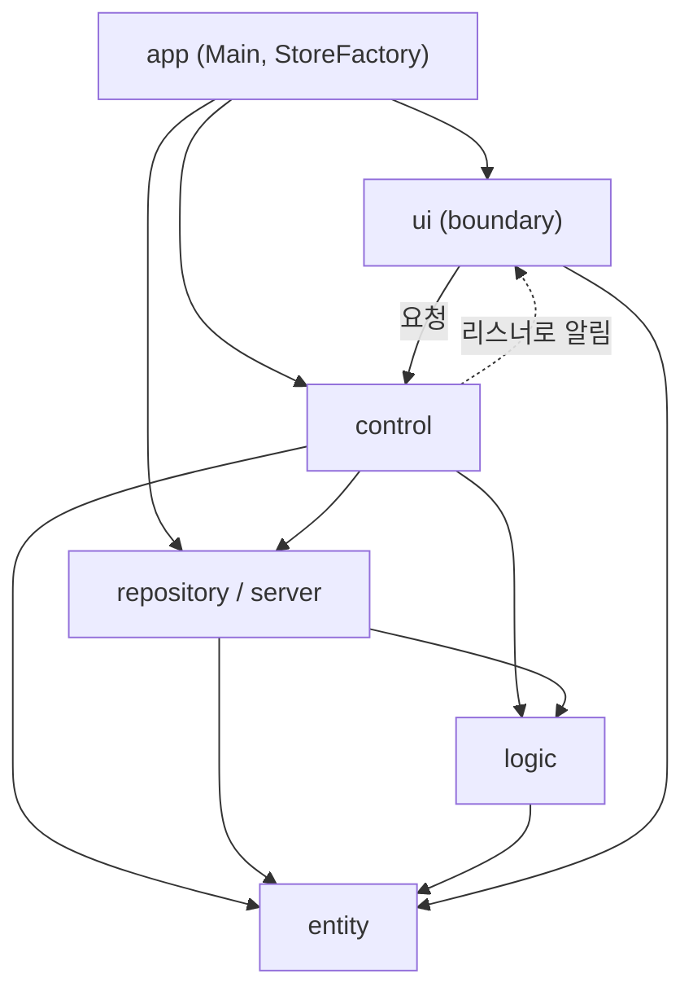
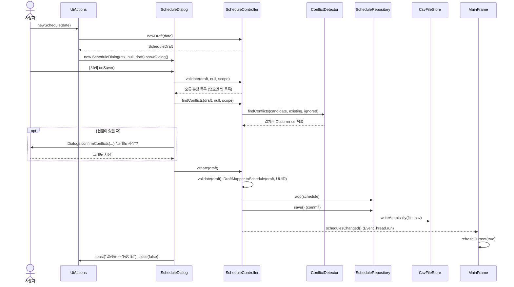
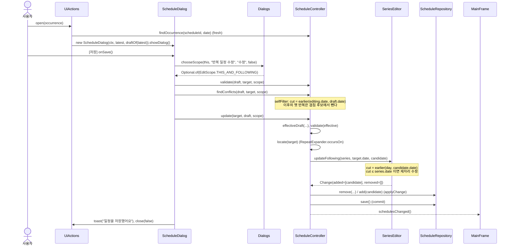
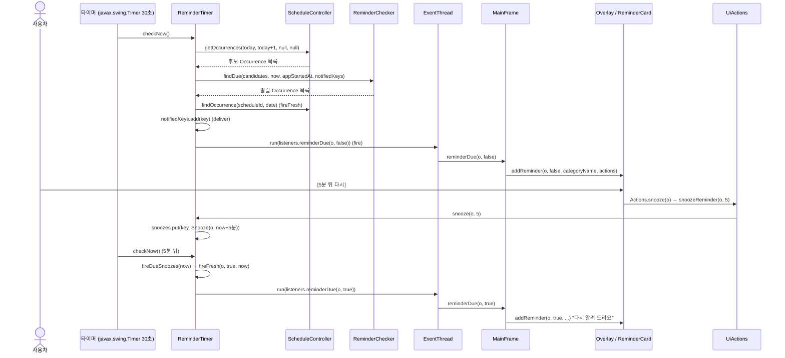
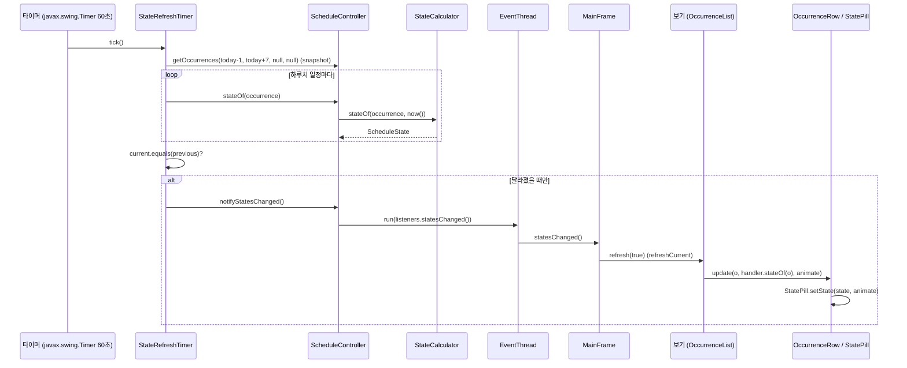

# 구조 설명

이 문서는 코드를 처음 읽는 사람이 "어느 클래스가 무엇을 하고, 누가 누구를 부르는지" 빨리 잡도록 쓴 안내입니다.
기능 번호(F1~F15)는 `docs/기능-흐름표.md`, 클래스 한 줄 설명은 `docs/클래스-목록표.md`를 보세요. 여기서는 **층 구조**와 **네 가지 대표 흐름**만 다룹니다.

---

## 1. 층 구조 (ECB + logic + repository)

ECB는 화면(Boundary), 흐름 담당(Control), 데이터(Entity)로 나누는 설계입니다. 이 프로젝트는 여기에 계산 규칙(logic)과 파일 저장(repository)을 따로 떼어 놓았습니다.

| 패키지 | 분류 | 하는 일 | 대표 클래스 |
|---|---|---|---|
| `proto.ui` (+ `ui.component`, `ui.dialog`, `ui.view`, `ui.layout`, `ui.motion`, `ui.theme`) | 경계 boundary | 화면을 그리고 사용자 동작을 받는다. 규칙은 모른다 | `MainFrame`, `UiActions`, `ScheduleDialog`, `OccurrenceList`, `Overlay` |
| `proto.control` | 제어 control | 화면의 요청을 순서대로 처리하고, 결과를 리스너로 알린다. 시간으로 도는 타이머도 여기 있다 | `ScheduleController`, `CategoryController`, `ReminderTimer`, `StateRefreshTimer` |
| `proto.entity` | 개체 entity | 일정·카테고리처럼 이름이 있는 데이터. 다른 패키지를 모른다 | `Schedule`, `Occurrence`, `Category`, `ScheduleState` |
| `proto.logic` | 논리 application logic | 입력만으로 결과가 나오는 규칙 계산 (정적 메서드). 저장소·화면 없이 시험할 수 있다 | `ScheduleValidator`, `RepeatExpander`, `SeriesEditor`, `ConflictDetector`, `StateCalculator`, `ReminderChecker` |
| `proto.repository` | 저장소 repository | 메모리의 일정 목록과 CSV 파일을 오간다 | `ScheduleRepository`, `CategoryRepository`, `CsvFileStore`, `CsvCodec` |
| `proto.server` | 저장소(서버 대비) | 서버가 켜져 있을 때만 저장소를 감싸는 보조 저장 (기본은 꺼져 있다) | `SyncingScheduleStore`, `ServerSettings` |
| `proto.app` | 시작 | 모든 부품을 만들어 이어 붙인다 | `Main`, `StoreFactory` |

### 의존 방향

코드의 `import`로 실제로 확인한 규칙입니다.

1. **ui는 control만 부른다.** `ui` 안에는 `proto.logic`·`proto.repository`를 가져오는 곳이 없고, entity(데이터)와 control만 쓴다. 규칙 계산이 필요하면 `ScheduleController`의 메서드(`validate`, `findConflicts`, `stateOf` …)를 거친다.
2. **control은 결과를 리스너로 돌려준다.** `ScheduleListener`, `CategoryListener`, `ReminderListener`를 `MainFrame`이 구현하고 `attachListeners`에서 등록한다. control은 ui 클래스를 import하지 않는다.
3. **리스너 호출은 항상 화면 스레드에서.** `EventThread.run`이 이벤트 스레드(EDT)이면 바로, 아니면 `invokeLater`로 넘긴다 (화면이 없는 시험 환경에서는 바로 실행한다).
4. **entity는 아무도 모른다.** 가장 아래 층이라 다른 패키지를 import하지 않는다.
5. **logic은 상태가 없다.** 같은 입력이면 같은 결과이고, 시계가 필요하면 `now`를 인자로 받는다.

### 이 앱이 지키는 설계 약속

- **상태는 저장하지 않고 계산한다.** 예정/진행 중/지연/완료 중 "완료"만 일정에 기록되고(완료한 날짜), 나머지는 `StateCalculator#stateOf(occurrence, now)`가 지금 시각으로 구한다.
- **시간 구간은 반개구간 `[시작, 끝)`.** 10:00에 끝나는 일정과 10:00에 시작하는 일정은 겹치지 않고(`ConflictDetector#overlaps`), 끝 시각 정각부터는 "진행 중"이 아니라 "지연"이다.
- **저장은 통째로, 안전하게.** 변경이 있을 때마다 메모리 목록 전체를 CSV로 다시 쓴다 (4장 참고).
- **알림은 한 번만.** `ReminderTimer`가 이미 알린 일정 키(`일정id@날짜`)를 기억한다.

---

## 2. 대표 흐름 네 가지

각 그림의 이름은 모두 실제 클래스·메서드입니다 (`Class#method`). 화면의 안내 문구와 대안 흐름은 `기능-흐름표.md`에 있습니다.

### 2-1. 일정 등록 (F1 + 겹침 경고 F13)

1. 사용자가 사이드바의 "새 일정"(또는 `Ctrl/⌘+N`)을 누르면 `UiActions#newSchedule(date)`가 `ScheduleController#newDraft`로 빈 입력값(`ScheduleDraft`)을 받아 `ScheduleDialog`를 연다.
2. [저장]을 누르면 `ScheduleDialog#onSave` → `save`가 입력을 읽고(`readDraft`), `ScheduleController#validate`로 검증한다. 오류가 있으면 `FieldErrors`가 해당 칸 아래에 보여 준다.
3. `ScheduleController#findConflicts`가 `ConflictDetector`로 시간이 겹치는 일정을 찾는다. 있으면 `Dialogs#confirmConflicts`로 "그래도 저장할까요?"를 묻는다.
4. `ScheduleController#create`가 한 번 더 검증하고 새 id(UUID)를 붙여 저장소에 넣는다 (`DraftMapper#toSchedule`).
5. `commit`이 `ScheduleRepository#save`로 CSV에 쓰고(F11), 리스너(`MainFrame#schedulesChanged`)가 화면을 새로 그린다.

### 2-2. 반복 일정 "앞으로 전부" 수정 (F3 / F9)

반복 일정은 한 줄(`Schedule`) 뒤에 날짜를 펼쳐서(`RepeatExpander#expand`) 보여 줍니다. 화면이 들고 있는 것은 그중 하루치(`Occurrence`)입니다.
"앞으로 전부"를 고르면 **자르는 날(cut) = min(고른 날, 새 시작일)** 을 기준으로 원래 반복을 전날에 끝내고, 새 반복을 따로 만듭니다. 두 날짜 중 이른 날에서 잘라야 옛 반복과 새 반복이 같은 날짜를 두 번 만들지 않습니다.

1. `UiActions#open(o)`가 `fresh`로 최신 값을 다시 읽고(`ScheduleController#findOccurrence`), `draftOf`로 입력값을 채워 `ScheduleDialog`를 연다.
2. 저장할 때 `ScheduleDialog#chooseScope`가 반복이면 `Dialogs#chooseScope`로 범위를 묻는다. 먼저 묻는 이유: "이 일정만"은 반복이 사라지는 수정이라 검증·겹침도 그 값으로 해야 한다.
3. `ScheduleController#update(target, draft, scope)`가 `effectiveDraft` → `validate` → `locate`(`RepeatExpander#occursOn`)로 원본을 찾는다.
4. `editSeries`가 범위에 따라 `SeriesEditor#updateFollowing`(앞으로 전부) 또는 `updateThisOnly`(이 일정만)를 고른다.
5. `updateFollowing`은 cut이 반복 시작일 이전/같으면 같은 일정을 그 자리에서 고치고, 아니면 `moveTail`/`trimSeriesBefore`로 원래 반복의 종료일을 cut의 전날로 줄이고 새 일정(candidate)을 `Change.added`에 담는다.
6. `applyChange`가 저장소에서 빼고 더한 뒤 `commit`으로 저장·알림한다.

### 2-3. 알림이 뜨고 다시 알리기 (F10 / F15) — 타이머가 움직이는 흐름

알림은 사용자가 시작하는 흐름이 아니라 **`ReminderTimer`(30초마다 도는 `javax.swing.Timer`)가 시작하는 흐름**입니다. `Main`이 `reminders.start()`를 부르면 그때부터 돕니다.

1. 타이머가 `ReminderTimer#checkNow`를 부른다 (이미 확인 중이면 바로 돌아간다).
2. `remindDue`가 오늘~내일 일정(`ScheduleController#getOccurrences`)을 후보로 모으고, `ReminderChecker#findDue(candidates, now, appStartedAt, notifiedKeys)`가 알림 시각(시작 − N분)이 "앱을 켠 시각 이상, 지금 이하"이고 아직 알리지 않은 것만 가려낸다.
3. `fireFresh`가 알리기 직전에 최신 값을 다시 확인하고(`findOccurrence`, `stillDue`), `deliver`가 **키를 먼저 `notifiedKeys`에 넣은 뒤** `fire`로 알린다 (같은 알림이 두 번 나가지 않게).
4. `fire` → `EventThread.run` → `MainFrame#reminderDue`가 `Overlay#addReminder`로 `ReminderCard`를 띄우고 `drawAttention`으로 소리·독 아이콘을 알린다.
5. 사용자가 [5분 뒤 다시]를 누르면 `ReminderCard.Actions#snooze` → `UiActions#snoozeReminder` → `ReminderTimer#snooze`가 메모리 지도 `snoozes`에 (key → 5분 뒤 시각)을 넣는다. 같은 일정을 다시 누르면 시각이 덮어써진다.
6. 5분 뒤 타이머가 `checkNow` → `fireDueSnoozes`로 시각이 된 예약을 먼저 지도에서 빼고, 하나씩 `fireFresh(…, true, now)`로 다시 알린다 (완료·삭제된 일정은 조용히 버린다).
7. [완료 처리]는 `UiActions#completeReminder` → `ScheduleController#setCompleted`로 이어지고, 저장 뒤 `MainFrame#schedulesChanged`가 `pruneReminders`로 완료된 일정의 카드를 치운다.

### 2-4. 상태 자동 계산 (F6)

상태는 파일에 없습니다. 보여 줄 때마다 지금 시각으로 계산하므로, **아무도 아무것도 누르지 않아도 시간이 지나면 "예정 → 진행 중 → 지연"이 저절로 바뀝니다.** 그 변화를 화면에 알리는 것이 `StateRefreshTimer`(60초마다)입니다.

1. 타이머가 `StateRefreshTimer#tick`을 부른다.
2. `snapshot`이 어제~7일 뒤의 하루치 일정(`getOccurrences`)마다 `ScheduleController#stateOf` → `StateCalculator#stateOf(occurrence, now)`로 상태를 구해 "키 → 상태" 지도를 만든다.
3. 지난번 지도(`previous`)와 다르면 `ScheduleController#notifyStatesChanged`로 알린다. 같으면 아무것도 하지 않는다 (매분 화면 전체를 다시 그리면 낭비이고 깜빡이므로).
4. `dispatch`가 `EventThread.run`으로 `MainFrame#statesChanged`를 부르고, `refreshCurrent(true)`가 보기를 다시 읽는다.
5. 보기의 `OccurrenceList#setItems`는 각 줄에 `RowHandler#stateOf`(= `UiActions#stateOf`)로 상태를 묻고, `OccurrenceRow`가 `StatePill#setState(state, animate)`로 알약 색을 부드럽게 바꾼다.
6. 일정이 바뀌어 저장될 때는 `StateRefreshTimer`의 내부 리스너 `Baseline#schedulesChanged`가 기준 지도를 새로 잡는다. 그래서 일정 수정이 "상태 변화"로 중복 알려지지 않는다.

---

## 3. 화면(ui) 안에서의 연결

- **`UiContext`** 가 controller 셋(`ScheduleController`, `CategoryController`, `ReminderTimer`), 화면 상태(`AppState`), 동작 모음(`UiActions`), 알림 층(`Overlay`), 크기 등급(`Breakpoints`)을 묶어 모든 화면에 나눠 준다.
- **`UiActions`** 는 "일정에 대한 동작"의 출입구다. 일정 줄·알림 카드·사이드바가 `RowHandler`(인터페이스)를 통해 요청하고, 실제 확인 창·controller 호출·토스트는 여기서 한다. 동작 직전에는 `fresh`로 최신 값을 다시 읽어 이미 지워진 일정을 다루지 않는다.
- **크기 등급**: `Breakpoints`가 창 크기를 논리 px로 `SizeClass`(WIDE/MEDIUM/COMPACT, 세로로 긴지, 낮은지)로 바꾸고, 등급이 **바뀔 때만** `MainFrame`·사이드바·각 보기의 `applySize`가 불린다.
- **애니메이션**: 모든 모션은 `Motion#run`을 거치고, 설정에서 꺼져 있으면(`Motion.enabled()`가 false) 시간을 기다리지 않고 끝 상태로 바로 간다. 그래서 화면 코드는 켜짐/꺼짐을 따로 나누지 않는다.
- **테마**: 색은 `Tokens`의 이름("proto.text" 등)으로만 쓰고, 실제 값은 `resources/proto/ui/theme/*.properties`(FlatLaf)에 밝은/어두운 테마별로 있다.

---

## 4. 데이터는 어떻게 저장되나

### 파일 위치

실행한 폴더의 `data/` 아래에 둔다 (`Main`의 `DATA_DIR`).

| 파일 | 내용 |
|---|---|
| `schedules.csv` | 일정 (한 줄 = 일정 하나. 반복 일정도 한 줄) |
| `categories.csv` | 카테고리 (`id,name`) |
| `app.lock` | 같은 데이터를 두 프로그램이 동시에 쓰지 못하게 하는 잠금 파일 |
| `server.properties` | (선택) 서버 사용 설정. 없거나 꺼져 있으면 서버 코드는 쓰이지 않는다 |
| `*-backup-yyyyMMdd-HHmmss[-n].csv` | 불러올 때 문제가 있었던 파일의 원본 백업 |

### `schedules.csv`의 열 (12개)

첫 줄은 열 이름이다 (`ScheduleCsvMapper#HEADER`).

| 열 | 뜻 | 예 |
|---|---|---|
| `id` | 일정 고유 번호 (UUID) | `3f2a…` |
| `title` | 제목 | `팀 회의` |
| `date` | 시작 날짜 (반복이면 첫 날) | `2026-11-16` |
| `start` | 시작 시간 | `10:00` |
| `end` | 끝 시간 (시작보다 늦어야 함) | `11:00` |
| `categoryId` | 카테고리 id | `team` |
| `memo` | 메모 (200자까지) | |
| `repeat` | `RepeatRule` 이름 | `NONE`, `DAILY`, `WEEKLY`, `MONTHLY` |
| `repeatEnd` | 반복 종료일 (없으면 빈 칸) | `2026-12-31` |
| `reminder` | `ReminderOption` 이름 | `NONE`, `FIVE_MINUTES`, `TEN_MINUTES`, `THIRTY_MINUTES` |
| `completedDates` | 완료한 날짜들 (ISO 날짜를 `;`로 이음) | `2026-11-16;2026-11-23` |
| `excludedDates` | 반복에서 뺀 날짜들 (같은 방식) | `2026-11-30` |

"예정/진행 중/지연" 같은 **상태 열은 없습니다.** 완료한 날짜만 기록하고 나머지는 읽을 때마다 계산합니다.
제목·메모에 쉼표나 줄바꿈이 있어도 `CsvCodec`이 따옴표 규칙(RFC 4180)으로 안전하게 쓰고 읽습니다.

### 안전하게 쓰기 (`CsvFileStore#writeAtomically`)

1. 같은 폴더에 임시 파일을 만들어 새 내용 전체를 쓴다.
2. 임시 파일을 원래 이름으로 옮겨 덮어쓴다 (`ATOMIC_MOVE`). 옮기는 도중의 반쯤 쓴 파일은 아무도 볼 수 없다.
3. 윈도우에서 다른 프로그램이 파일을 잡고 있으면 잠시 기다렸다가 다시 시도한다 (최대 5번).
4. 어떤 경우에도 임시 파일은 지운다.

그래서 쓰는 도중 앱이 꺼져도 파일은 "옛 내용 전체" 아니면 "새 내용 전체"입니다.

### 읽다가 문제가 있으면 (백업)

- 줄 하나가 깨졌으면(칸 수 오류, 날짜 모양 오류 등) 그 줄만 건너뛰고 경고(`getWarnings`)로 알린다. `Main`이 화면이 뜬 뒤 `reportLoadWarnings`로 보여 준다.
- 문제가 있었던 파일은 덮어쓰기 **전에** `CsvFileStore#backup`으로 원본을 `schedules-backup-20261114-093000.csv`처럼 보관한다. 같은 초에 또 만들면 `-1`, `-2`를 붙인다.
- 백업조차 못 했으면(`saveBlocked`) 저장을 막고 오류를 알린다. 읽지 못한 옛 기록이 조용히 사라지지 않게 하기 위해서이다.

### 저장 시점과 실패

- 일정·카테고리가 바뀔 때마다 `ScheduleController#commit`이 `save()`를 부른다 (F11).
- 저장이 실패해도 **메모리의 변경은 그대로 두고** "저장하는 중 문제가 생겼어요" 알림(자세히 버튼)을 띄운다. 사용자가 방금 넣은 일정이 사라지는 것보다 낫다고 보았기 때문이다.

### 한 번에 하나만 (`data/app.lock`)

`Main#acquireSingleInstanceLock`이 시작할 때 `FileChannel#tryLock`으로 `app.lock`을 잡고 프로세스가 끝날 때까지 놓지 않는다. 이미 다른 프로그램이 잡고 있으면 "이미 실행 중" 안내만 하고 끝낸다. 두 프로그램이 같은 CSV를 서로 덮어쓰는 일을 막는다.

### 서버(선택)

`data/server.properties`에서 켜면 `StoreFactory`가 CSV 저장소를 `SyncingScheduleStore`/`SyncingCategoryStore`로 감싼다. 기준은 언제나 **이 컴퓨터의 CSV**이고, 서버에는 저장할 때마다 통째로 올리기만 한다. 서버가 안 돼도 앱은 계속 쓸 수 있다 (경고만 남긴다). 자세한 약속은 `docs/server-api.md`를 보세요.
