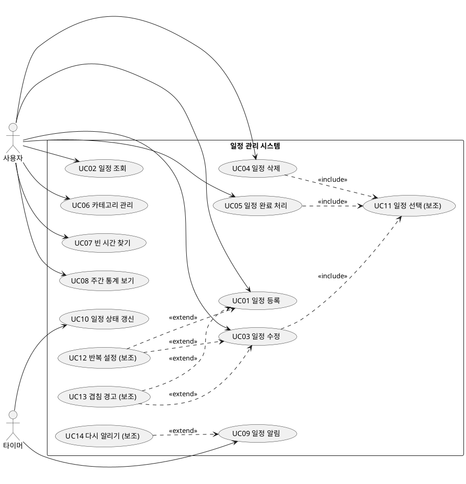

# 유스케이스 초안

2026-11-14 · 근거: [기능-흐름표.md](기능-흐름표.md), 프로토타입 계획서 3번 규칙

이 문서는 첫 번째 초안이다. 팀이 앱을 써 보고 고칠 점은 5번에 적었다.

---

## 1. 액터

| 액터 | 종류 | 이유 |
| --- | --- | --- |
| 사용자 | 주 액터 | 버튼, 메뉴, 단축키로 직접 시작한다. |
| 타이머 | 시간 액터 | 정해진 시간이 되면 스스로 시작한다. 알림은 30초마다, 상태 갱신은 1분마다 돈다. |

---

## 2. 유스케이스 후보

| 유스케이스 | 액터 | 묶이는 기능 | 관계 후보 |
| --- | --- | --- | --- |
| UC01 일정 등록 | 사용자 | F1 (입력 칸으로 F9, F10 포함) | 반복 설정 (extend), 겹침 경고 (extend) |
| UC02 일정 조회 | 사용자 | F2, F8 (검색) | — |
| UC03 일정 수정 | 사용자 | F3 | 일정 선택 (include), 반복 설정 (extend), 겹침 경고 (extend) |
| UC04 일정 삭제 | 사용자 | F4 | 일정 선택 (include) |
| UC05 일정 완료 처리 | 사용자 | F5 | 일정 선택 (include) |
| UC06 카테고리 관리 | 사용자 | F7 | — |
| UC07 빈 시간 찾기 | 사용자 | F12 | — |
| UC08 주간 통계 보기 | 사용자 | F14 | — |
| UC09 일정 알림 | 타이머 | F10 | 다시 알리기 (extend) |
| UC10 일정 상태 갱신 | 타이머 | F6 | — |

**관계 이유 (한 줄씩)**

- 일정 수정 → 일정 선택 (include): 수정할 일정을 고르고 최신 내용을 읽는 단계가 같아서 따로 뺐다.
- 일정 삭제 → 일정 선택 (include): 위와 같은 이유다.
- 일정 완료 처리 → 일정 선택 (include): 위와 같은 이유다.
- 반복 설정 → 일정 등록 (extend): 사용자가 반복을 고를 때만 생기는 추가 동작이다.
- 반복 설정 → 일정 수정 (extend): 수정 때 반복을 바꿀 때만 생기는 추가 동작이다.
- 겹침 경고 → 일정 등록 (extend): 시간이 겹칠 때만 나오는 추가 동작이다.
- 겹침 경고 → 일정 수정 (extend): 수정 때 시간이 겹칠 때만 나오는 추가 동작이다.
- 다시 알리기 → 일정 알림 (extend): 사용자가 카드에서 "5분 뒤 다시"를 누를 때만 일어나는 추가 동작이다.

**보조 유스케이스 (표 밖)**

표는 10행까지만 쓰기로 해서, 아래 4개는 표 밖에 두었다. 다이어그램과 명세에는 모두 넣었다.

- UC11 일정 선택: 수정, 삭제, 완료 처리가 함께 쓰는 단계다.
- UC12 반복 설정: 등록과 수정에서 쓰는 반복 규칙 입력이다.
- UC13 겹침 경고: 등록과 수정에서 쓰는 시간 겹침 확인이다.
- UC14 다시 알리기: 알림 카드의 "5분 뒤 다시" 기능이다.

**합치기, 나누기 기록**

- F8 검색은 별도 유스케이스로 두지 않고 UC02에 합쳤다.
- F7의 거르기(카테고리로 보기)는 UC06에 두었다. 위치는 확인이 필요하다 (5번 질문 4).
- F11 자동 저장은 유스케이스가 아니다. 저장하는 모든 유스케이스 안의 한 단계다.
- F12의 "이 시간에 추가"는 UC07에서 UC01로 넘어가는 흐름이다. 관계는 아니다.
- F9의 "이 일정만 / 앞으로 전부" 선택은 UC03, UC04 안의 단계다. 별도 유스케이스가 아니다.
- F6 상태 계산은 사용자 목표가 아니다. 그래도 타이머 액터의 일로 UC10에 두었다 (5번 질문 5).

---

## 3. 유스케이스 다이어그램

UC11은 다른 유스케이스 안에 포함되는 단계이고, UC12~UC14는 기본 유스케이스를 확장하는 동작이라 액터와 직접 잇지 않았다. 화살표 방향은 UML 규칙대로 include는 기본 → 포함, extend는 확장 → 기본이다.

---

## 4. 명세

### UC01 일정 등록

- **이름**: 일정 등록
- **액터**: 사용자
- **개요**: 사용자가 새 일정을 만들어 저장한다.
- **사전 조건**: 앱이 실행 중이다. 카테고리가 하나 이상 있다.
- **기본 흐름**
  1. 사용자: "새 일정"(사이드바, Ctrl/⌘+N, "이 날에 일정 추가")을 누른다. 시스템: 09:00–10:00, 카테고리 "개인", 반복과 알림 없음으로 등록 창을 연다.
  2. 사용자: 제목, 날짜, 시작과 끝 시간, 카테고리, 메모를 입력한다. 반복(UC12)과 알림도 정한다. "저장"을 누른다. 시스템: 입력값을 확인한다.
  3. 시스템: 같은 시간의 다른 일정을 확인한다(UC13). 새 id를 만든다.
  4. 시스템: 파일에 저장하고(F11) 화면을 다시 그린다.
  5. 시스템: "일정을 추가했어요"를 보여 주고 창을 닫는다.
- **대안 흐름**
  - 2a. 제목이 비었으면 "제목을 입력해 주세요"를 보여 준다. 50자를 넘으면 "제목은 50자까지 쓸 수 있어요"를 보여 준다.
  - 2b. 끝 시간이 시작 시간보다 빠르면 "끝 시간은 시작 시간보다 늦어야 해요"를 보여 준다.
  - 2c. 메모가 200자를 넘으면 "메모는 200자까지 쓸 수 있어요"를 보여 준다.
  - 2d. 카테고리를 고르지 않으면 "카테고리를 선택해 주세요"를 보여 준다.
  - 2e. 시간을 읽을 수 없으면 "시작 시간을 14:00처럼 입력해 주세요"를 보여 준다.
  - 2f. 반복 종료일이 시작 날짜보다 빠르면 "반복 종료일은 시작 날짜보다 빠를 수 없어요"를 보여 준다.
  - 2g. 사용자가 "취소"나 Esc를 누르면 아무것도 저장하지 않고 닫는다.
  - 3a. 겹치는 일정이 있으면 UC13을 실행한다. "돌아가기"를 고르면 입력값을 두고 2로 돌아간다.
  - 4a. 저장에 실패하면 메모리에는 남기고 "저장하는 중 문제가 생겼어요"를 보여 준다.
  - 4b. "저장"을 두 번 눌러도 한 번만 저장한다.
- **사후 조건**: 일정이 파일에 한 줄 더 추가된다. 저장에 실패하면 메모리에만 있다.
- **관련 기능**: F1, F9, F10, F11, F13

### UC02 일정 조회

- **이름**: 일정 조회
- **액터**: 사용자
- **개요**: 사용자가 오늘, 이번 주, 달력에서 일정을 본다.
- **사전 조건**: 앱이 실행 중이다.
- **기본 흐름**
  1. 사용자: 보기(오늘, 이번 주, 달력)를 고른다. Ctrl/⌘+1, 2, 3으로도 고를 수 있다. 시스템: 기간의 일정을 날짜별로 펼친다. 반복 일정도 날짜마다 펼친다(UC12). 날짜, 시작 시간, 제목 순으로 정렬한다.
  2. 사용자: 이전, 오늘, 다음으로 옮기거나 날짜를 고른다. 시스템: 그 날짜의 일정을 보여 준다. 각 일정의 상태(F6)와 카테고리를 함께 보여 준다.
- **대안 흐름**
  - 1a. 일정이 없으면 "오늘은 일정이 없어요", "이 날은 일정이 없어요", "이 달에는 일정이 없어요" 중 맞는 문구를 보여 준다.
  - 1b. 좁은 화면에서는 아젠다 목록과 점 표시로 바꿔 보여 준다.
  - 2a. 검색 창에 검색어를 넣으면 제목과 메모에서 찾아 같은 목록에 보여 준다. 대소문자는 가리지 않는다. 결과가 없으면 "조건에 맞는 일정이 없어요. 검색어나 카테고리를 바꿔 보세요"를 보여 준다. (확인 필요: 검색을 기본 흐름으로 볼지 여부)
- **사후 조건**: 데이터는 바뀌지 않는다.
- **관련 기능**: F2, F6, F8, F9

### UC03 일정 수정

- **이름**: 일정 수정
- **액터**: 사용자
- **개요**: 사용자가 있는 일정의 내용을 바꾼다.
- **사전 조건**: 수정할 일정이 목록에 있다.
- **기본 흐름**
  1. 사용자: 일정 행을 누르거나 Enter를 누른다. 메뉴에서 "수정"을 고를 수도 있다. 시스템: 일정 선택(UC11)으로 최신 내용을 읽고, 채워진 등록 창을 연다.
  2. 사용자: 내용을 고치고 "저장"을 누른다. 시스템: 반복 일정이면 "반복 일정을 수정할까요?"를 묻는다. 선택지는 취소, 이 일정만, 앞으로 전부다.
  3. 사용자: 범위를 고른다. 시스템: UC01과 같은 입력 확인을 한다. 겹침 확인(UC13)에서 자기 자신은 뺀다.
  4. 시스템: 고른 범위로 바꾸고 저장한다(F11). 이 일정만은 그 날짜만 따로 바꾸고, 앞으로 전부는 그 날짜부터 바꾼다. "일정을 저장했어요"를 보여 주고 창을 닫는다.
- **대안 흐름**
  - 1a. 다른 곳에서 이미 지웠으면 "이미 지워진 일정이에요"를 보여 주고 화면을 새로 고친다.
  - 2a. 사용자가 취소하면 바꾸지 않고 닫는다.
  - 3a. 입력 오류는 UC01 2a–2f와 같은 문구를 보여 준다.
  - 3b. 저장할 때 일정이 없으면 "일정을 찾을 수 없어요. 이미 바뀌었거나 지워졌을 수 있어요"를 보여 준다.
  - 3c. 겹치면 UC13을 실행한다. "돌아가기"를 고르면 입력값을 두고 2로 돌아간다.
  - 4a. 저장에 실패하면 메모리에는 바뀐 내용을 남기고 "저장하는 중 문제가 생겼어요"를 보여 준다.
- **사후 조건**: 모든 보기에 바뀐 내용이 보인다. 파일은 저장에 성공했을 때만 바뀐다.
- **관련 기능**: F3, F9, F11, F13

### UC04 일정 삭제

- **이름**: 일정 삭제
- **액터**: 사용자
- **개요**: 사용자가 일정 하나를 지운다.
- **사전 조건**: 지울 일정이 목록에 있다.
- **기본 흐름**
  1. 사용자: 수정 창의 "삭제", 메뉴의 "삭제", 또는 Delete나 Backspace를 누른다. 시스템: 일정 선택(UC11)으로 최신 내용을 읽는다.
  2. 시스템: 반복이 없는 일정이면 "‘제목’을(를) 삭제할까요?"와 "삭제한 일정은 되돌릴 수 없어요."를 보여 준다. 반복 일정이면 "반복 일정을 삭제할까요?"를 보여 준다. 선택지는 취소, 이 일정만, 앞으로 전부다. 반복 일정은 따로 확인 창이 없다.
  3. 사용자: 삭제를 확인한다. 시스템: 목록에서 지우고 파일에 저장한다(F11). "일정을 삭제했어요"를 보여 준다. 알림 카드도 지운다.
- **대안 흐름**
  - 1a. 이미 지워졌으면 "이미 지워진 일정이에요"를 보여 주고 화면을 새로 고친다.
  - 2a. 사용자가 취소하면 아무것도 지우지 않는다.
  - 3a. 같은 삭제를 두 번 눌러도 한 번만 처리한다.
  - 3b. 저장에 실패하면 메모리에서는 지운 상태로 두고 "저장하는 중 문제가 생겼어요"를 보여 준다.
- **사후 조건**: 목록과 알림 카드에서 사라진다. 저장에 성공하면 파일에서도 지워진다.
- **관련 기능**: F4, F9, F10, F11

### UC05 일정 완료 처리

- **이름**: 일정 완료 처리
- **액터**: 사용자
- **개요**: 사용자가 일정을 완료로 표시하거나, 완료를 취소한다.
- **사전 조건**: 완료할 일정이 목록에 있다.
- **기본 흐름**
  1. 사용자: 체크박스, 메뉴의 "완료" 또는 "완료 취소", 알림 카드의 "완료 처리"를 누른다. 시스템: 일정 선택(UC11)으로 최신 내용을 읽는다.
  2. 시스템: 그 날짜의 완료 여부만 바꾼다. 반복 일정의 완료는 날짜마다 따로 기억한다. 파일에 저장한다(F11).
  3. 시스템: 상태를 "완료"로 바꿔 보여 준다(F6). "일정을 완료했어요" 또는 "완료를 취소했어요"를 보여 준다.
- **대안 흐름**
  - 1a. 이미 지워졌으면 "이미 지워진 일정이에요"를 보여 주고 화면을 새로 고친다.
  - 1b. 알림 카드에서 이미 지웠거나 완료한 일정이면 "이미 지워졌거나 완료한 일정이에요"를 보여 주고 카드를 닫는다.
  - 2a. 저장에 실패하면 메모리에는 남기고 "저장하는 중 문제가 생겼어요"를 보여 준다.
- **사후 조건**: 완료 여부가 바뀐다. 상태가 화면에 바로 반영된다.
- **관련 기능**: F5, F6, F10, F11

### UC06 카테고리 관리

- **이름**: 카테고리 관리
- **액터**: 사용자
- **개요**: 사용자가 카테고리를 추가하거나 이름을 바꾸거나 지운다. 카테고리로 일정을 거를 수도 있다.
- **사전 조건**: 기본 카테고리(수업, 과제, 팀플, 개인)가 있다.
- **기본 흐름**
  1. 사용자: 사이드바의 "편집"에서 "카테고리 관리"를 연다. 시스템: 카테고리 목록을 보여 준다.
  2. 사용자: 새 이름을 입력하고 추가한다. 시스템: 앞뒤 공백을 지운다. 1–20자인지, 같은 이름이 없는지(대소문자 무시) 확인한다. 끝에 붙이고 `data/categories.csv`에 저장한다(F11). "카테고리를 추가했어요"를 보여 준다.
  3. 사용자: 이름 바꾸기 또는 휴지통 아이콘을 누른다. 삭제라면 확인 창을 연다.
  4. 시스템: "‘이름’ 카테고리를 지울까요?"를 보여 준다. 일정이 있으면 "일정 N개가 ‘개인’으로 옮겨져요."를, 없으면 "이 카테고리에는 일정이 없어요."를 보여 준다. 사용자가 "삭제"를 누른다.
  5. 시스템: 옮길 일정을 `schedules.csv`에 먼저 저장한다. 그다음 카테고리를 지우고 `categories.csv`에 저장한다. "카테고리를 삭제했어요"를 보여 준다.
  6. 사용자: 사이드바에서 카테고리를 누르거나 "전체"를 누른다. 시스템: 그 카테고리의 일정만 보여 준다. (확인 필요: 거르기를 이 유스케이스에 둘지 여부)
- **대안 흐름**
  - 2a. 이름이 비었으면 "카테고리 이름을 입력해 주세요"를 보여 준다. 20자를 넘으면 "카테고리 이름은 20자까지 쓸 수 있어요"를 보여 준다. 같은 이름이 있으면 "이미 있는 이름이에요"를 보여 준다.
  - 2b. 이름을 바꿀 때 원래 이름과 같으면 그대로 허용한다.
  - 3a. "개인"은 지울 수 없다. "‘개인’은 지울 수 없어요"를 보여 준다.
  - 3b. 없는 카테고리면 "없는 카테고리예요"를 보여 준다.
  - 4a. 취소하면 아무것도 바꾸지 않는다.
  - 5a. 일정 파일 저장에 실패하면 옮긴 일정을 원래대로 되돌린다. 카테고리는 지우지 않고 "저장하지 못해서 카테고리를 지우지 않았어요"를 보여 준다.
  - 5b. 카테고리 파일 저장만 실패하면 삭제는 그대로 두고 저장 오류를 보여 준다.
  - 6a. 거르고 있던 카테고리를 지우면 필터는 "전체"로 돌아간다.
- **사후 조건**: 카테고리와 일정이 맞다. 옮겨진 일정은 "개인"에 있다. 두 파일이 바뀐다.
- **관련 기능**: F7, F8, F11

### UC07 빈 시간 찾기

- **이름**: 빈 시간 찾기
- **액터**: 사용자
- **개요**: 사용자가 날짜와 필요한 시간을 고르면 비어 있는 시간을 보여 준다.
- **사전 조건**: 앱이 실행 중이다.
- **기본 흐름**
  1. 사용자: 사이드바의 "빈 시간 찾기"를 연다. 시스템: 날짜, 필요한 시간(30분, 1시간, 1시간 30분, 2시간, 직접), 시간대를 채운 창을 연다. 시간대는 설정의 "기본 활동 시간대"가 기본값이다.
  2. 사용자: 값을 고른다. 시스템: 그 날의 모든 일정(완료 포함)으로 빈 시간을 계산한다. 겹친 구간은 합친다. 오늘이면 지금부터 5분 단위로 올려서 계산한다. 카테고리와 검색 필터는 무시한다.
  3. 시스템: "10:00 – 12:00 · 2시간 비어 있어요" 같은 목록을 보여 준다.
  4. 사용자: "이 시간에 추가"를 누른다. 시스템: 창을 닫고 일정 등록(UC01)을 그 날짜, 시작, 끝 값으로 연다.
- **대안 흐름**
  - 1a. 시간대 시작이 끝보다 늦으면 "시간대를 14:00처럼 시작이 끝보다 빠르게 입력해 주세요"를 보여 준다.
  - 1b. "직접" 시간은 15~480분 안에서 15분 단위로만 고를 수 있다. 입력 칸이 범위 밖 값을 받지 않는다.
  - 2a. 빈 시간이 없으면 "이 날은 빈 시간이 없어요"를 보여 준다.
  - 3a. 닫기나 Esc를 누르면 아무 일도 없다.
- **사후 조건**: 데이터는 바뀌지 않는다.
- **관련 기능**: F12

### UC08 주간 통계 보기

- **이름**: 주간 통계 보기
- **액터**: 사용자
- **개요**: 사용자가 한 주의 일정 통계를 본다.
- **사전 조건**: 앱이 실행 중이다.
- **기본 흐름**
  1. 사용자: 사이드바의 "주간 통계"를 연다(Ctrl/⌘+4). 시스템: 지금 보고 있는 날짜가 속한 주(월요일–일요일)를 고른다.
  2. 시스템: 그 주의 날짜별 일정을 모은다. 반복 일정은 펼친다. 카테고리와 검색 필터는 적용하지 않는다.
  3. 시스템: 전체 일정 수, 완료 수와 완료율, 지금 기준 지연 수, 카테고리별 계획 시간, 요일별 일정 수를 보여 준다.
  4. 사용자: 이전이나 다음을 누른다. 시스템: 그 주로 다시 계산해서 보여 준다.
- **대안 흐름**
  - 1a. 검색 창은 숨긴다. "통계에는 검색이 적용되지 않아요"를 보여 준다.
  - 2a. 그 주에 일정이 없으면 "이 주에는 일정이 없어요"와 "일정을 추가하면 계획 시간과 완료율을 볼 수 있어요"를 보여 준다. "새 일정" 버튼도 보여 준다.
  - 3a. 일정이 바뀌면 통계를 다시 계산한다.
- **사후 조건**: 데이터는 바뀌지 않는다.
- **관련 기능**: F14, F8, F9

### UC09 일정 알림

- **이름**: 일정 알림
- **액터**: 타이머
- **개요**: 알림 시각이 되면 "곧 시작해요" 카드를 한 번 띄운다.
- **사전 조건**: 일정에 5, 10, 30분 전 알림이 설정되어 있다. "알림 없음"은 대상이 아니다. 앱이 실행 중이다.
- **기본 흐름**
  1. 타이머: 30초마다 오늘과 내일 일정을 본다. 알림 시각(시작 − N분)이 된 일정을 찾는다.
  2. 시스템: 앱을 켠 뒤에 지나간 알림만 고른다. 완료하지 않은 것, 아직 알리지 않은 것만 남긴다. 일정 id와 날짜로 구분한다.
  3. 시스템: 보여 주기 직전에 최신 내용을 다시 읽는다. 아직 있고 완료하지 않았으면 "곧 시작해요" 카드를 띄운다. 카드는 닫을 때까지 남고, 포커스를 빼앗지 않는다.
  4. 시스템: 소리 설정이 켜져 있으면 소리를 낸다. 창이 활성 상태가 아니면 Dock이나 작업 표시줄을 깜빡인다.
  5. 사용자: "닫기", "완료 처리"(UC05), "5분 뒤 다시"(UC14) 중 하나를 고른다. (확인 필요: 카드의 "완료 처리"를 UC05와 연결할지 여부)
- **대안 흐름**
  - 2a. 앱이 꺼져 있던 동안 지나간 알림은 보내지 않는다.
  - 2b. 같은 일정과 같은 날짜는 한 번만 알린다. 반복 일정은 날짜마다 따로 알린다.
  - 3a. 보여 주기 전에 일정이 지워졌거나 완료됐으면 카드를 띄우지 않는다. 이미 떠 있는 카드는 지운다.
- **사후 조건**: 카드가 화면에 뜬다. 알린 일정과 날짜가 기록된다. 이 기록은 메모리에만 있어서 앱을 다시 켜면 비워진다. 파일은 바뀌지 않는다.
- **관련 기능**: F10, F5, F15

### UC10 일정 상태 갱신

- **이름**: 일정 상태 갱신
- **액터**: 타이머
- **개요**: 1분마다 일정 상태를 다시 계산해서 화면과 맞춘다.
- **사전 조건**: 앱이 실행 중이다. 상태는 파일에 저장하지 않는다.
- **기본 흐름**
  1. 타이머: 1분마다 어제부터 7일 뒤까지의 일정을 현재 시각 기준으로 계산한다.
  2. 시스템: 상태를 정한다. 완료 표시가 있으면 "완료". 시작 전이면 "예정". 시작과 끝 사이면 "진행 중". 끝났는데 완료하지 않았으면 "지연".
  3. 시스템: 이전 계산과 달라진 것이 있을 때만 화면을 다시 그린다.
- **대안 흐름**
  - 1a. 일정을 추가, 수정, 삭제, 완료하면 기준값을 새로 잡는다.
  - 1b. 날짜가 바뀌면 상태를 다시 확인한다.
  - 3a. 바뀐 것이 없으면 다시 그리지 않는다.
- **사후 조건**: 화면의 상태가 지금 시각과 맞다. 파일은 바뀌지 않는다.
- **관련 기능**: F6

### UC11 일정 선택 (보조)

- **이름**: 일정 선택
- **액터**: 사용자 (수정, 삭제, 완료 처리 안에서 쓰는 포함 유스케이스)
- **개요**: 사용자가 목록에서 바꿀 일정 하나를 고르고, 최신 내용을 읽는다.
- **사전 조건**: 목록에 일정이 있다.
- **기본 흐름**
  1. 사용자: 일정 행을 누르거나 Enter를 누른다. 시스템: 그 일정과 날짜를 고른다. 반복 일정이면 날짜도 함께 넘긴다.
  2. 시스템: 저장소(메모리)에서 그 일정의 최신 내용을 다시 찾는다.
  3. 시스템: 최신 내용을 호출한 유스케이스에 넘긴다.
- **대안 흐름**
  - 2a. 이미 지워졌으면 "이미 지워진 일정이에요"를 보여 주고 화면을 새로 고친다. 이 유스케이스를 끝낸다.
- **사후 조건**: 고른 일정 하나가 호출한 유스케이스에 넘어간다.
- **관련 기능**: F3, F4, F5

### UC12 반복 설정 (보조)

- **이름**: 반복 설정
- **액터**: 사용자
- **개요**: 사용자가 일정의 반복 규칙과 종료일을 정한다.
- **사전 조건**: 일정 등록 또는 수정 창이 열려 있다.
- **기본 흐름**
  1. 사용자: "반복" 칸에서 반복 안 함, 매일, 매주(요일 기준), 매월(날짜 기준) 중 하나를 고른다. 시스템: 반복을 골랐으면 종료일 입력 칸을 보여 준다.
  2. 사용자: 필요하면 "반복 종료일"을 켜고 날짜를 고른다. 시스템: 종료일이 시작 날짜보다 빠르지 않은지 확인한다.
  3. 사용자: "저장"을 누른다. 시스템: 일정 하나와 반복 규칙 한 줄을 저장한다. 날짜마다 따로 복사하지 않는다. 보기에서는 날짜별로 펼친다(UC02).
- **대안 흐름**
  - 1a. 반복 안 함을 고르면 종료일 칸을 숨긴다.
  - 2a. 종료일이 시작 날짜보다 빠르면 "반복 종료일은 시작 날짜보다 빠를 수 없어요"를 보여 준다.
  - 3a. 매월 31일처럼 그 달에 없는 날은 건너뛴다.
  - 3b. 수정할 때는 UC03의 "이 일정만", "앞으로 전부" 규칙을 따른다.
- **사후 조건**: 반복 규칙이 한 줄로 저장된다.
- **관련 기능**: F9, F3, F4, F5, F11

### UC13 겹침 경고 (보조)

- **이름**: 겹침 경고
- **액터**: 사용자 (등록·수정 안에서 시스템이 시작)
- **개요**: 저장하려는 시간이 다른 일정과 겹치면 경고하고, 사용자가 계속할지 정한다.
- **사전 조건**: UC01의 입력 확인을 통과했다.
- **기본 흐름**
  1. 시스템: 같은 날의 다른 일정 중 시간이 겹치는 것을 찾는다. 끝과 시작이 맞닿은 것은 겹치지 않는다. 반복 일정은 시작 날짜부터 28일 안에서만 확인한다.
  2. 시스템: 겹치는 일정이 있으면 "시간이 겹쳐요 — 이 시간에 다른 일정이 있어요"와 목록을 보여 준다. 많으면 "외 N개"로 줄인다.
  3. 사용자: "그래도 저장" 또는 "돌아가기"를 고른다. 시스템: "그래도 저장"이면 저장을 이어 간다.
- **대안 흐름**
  - 1a. 겹치는 일정이 없으면 바로 저장한다.
  - 1b. 수정 중인 자기 자신은 세지 않는다. "앞으로 전부"면 자신과 그 뒤 날짜를, "이 일정만"이면 그 날짜만 뺀다.
  - 3a. "돌아가기"를 고르면 입력값을 그대로 두고 입력 화면으로 돌아간다.
- **사후 조건**: 경고는 저장을 막지 않는다. 사용자의 선택이 적용된다.
- **관련 기능**: F13, F1, F3

### UC14 다시 알리기 (보조)

- **이름**: 다시 알리기
- **액터**: 사용자
- **개요**: 알림 카드에서 "5분 뒤 다시"를 누르면 5분 뒤에 한 번 더 알린다.
- **사전 조건**: UC09의 알림 카드가 화면에 있다.
- **기본 흐름**
  1. 사용자: 카드의 "5분 뒤 다시"를 누른다. 시스템: 최신 일정을 다시 읽는다.
  2. 시스템: 지금부터 5분 뒤를 메모리에 예약하고 카드를 닫는다. "5분 뒤에 다시 알려 드려요"를 보여 준다.
  3. 타이머: 30초마다 확인하다가 예약 시각이 지나면 예약을 지운다. "다시 알려 드려요" 카드를 한 번 띄운다.
- **대안 흐름**
  - 1a. 그 사이에 일정을 지웠거나 완료했으면 "이미 지워졌거나 완료한 일정이에요"를 보여 주고 카드를 닫는다.
  - 1b. 다시 누르면 예약 시각을 새로 덮어쓴다.
  - 3a. 예약 시각이 됐을 때 이미 지워졌거나 완료됐으면 카드를 띄우지 않고 조용히 버린다.
- **사후 조건**: 예약이 하나 생겼다가, 시각이 되면 지워진다. 데이터는 바뀌지 않는다. 앱을 끄면 예약도 사라진다.
- **관련 기능**: F15, F10

---

## 5. 써 보면서 고칠 것

팀이 앱을 2~3일 써 보고 아래 질문에 답한다.

- [ ] 일정 선택(UC11)을 따로 둘까, 아니면 수정, 삭제, 완료 처리 안에 그냥 넣을까?
- [ ] 반복 설정(UC12)과 겹침 경고(UC13)를 확장(extend)으로 둘까, 아니면 등록과 수정의 기본 흐름 안 단계로 볼까?
- [ ] 알림 카드의 "완료 처리" 버튼은 일정 완료 처리(UC05)와 연결할까, 아니면 카드 안의 버튼으로만 볼까?
- [ ] 카테고리 거르기와 검색은 일정 조회(UC02)에 둘까, 아니면 따로 유스케이스로 뺄까?
- [ ] 일정 상태 갱신(UC10)은 사용자 목표가 아니니, 유스케이스에서 빼고 시스템 내부 일로 볼까?
